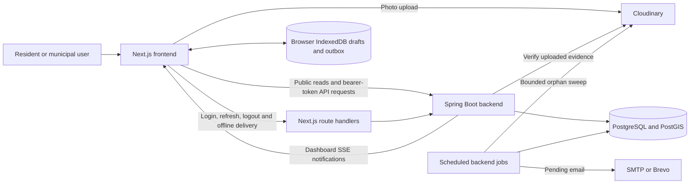
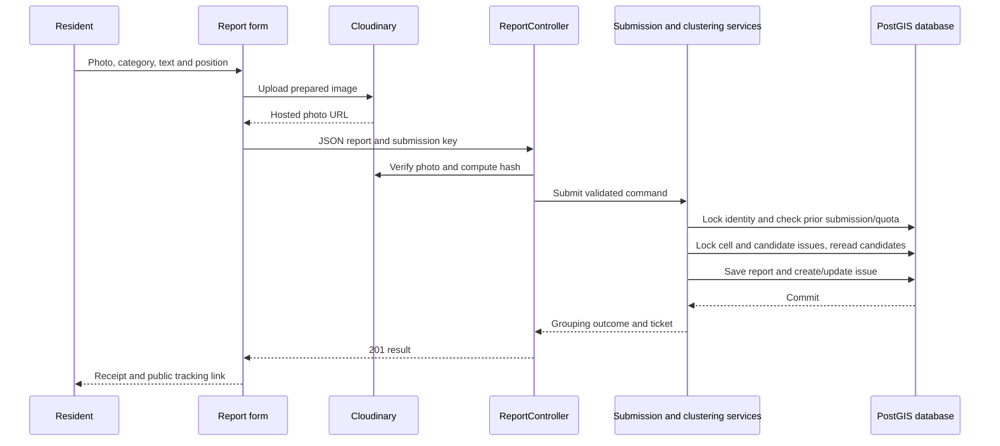
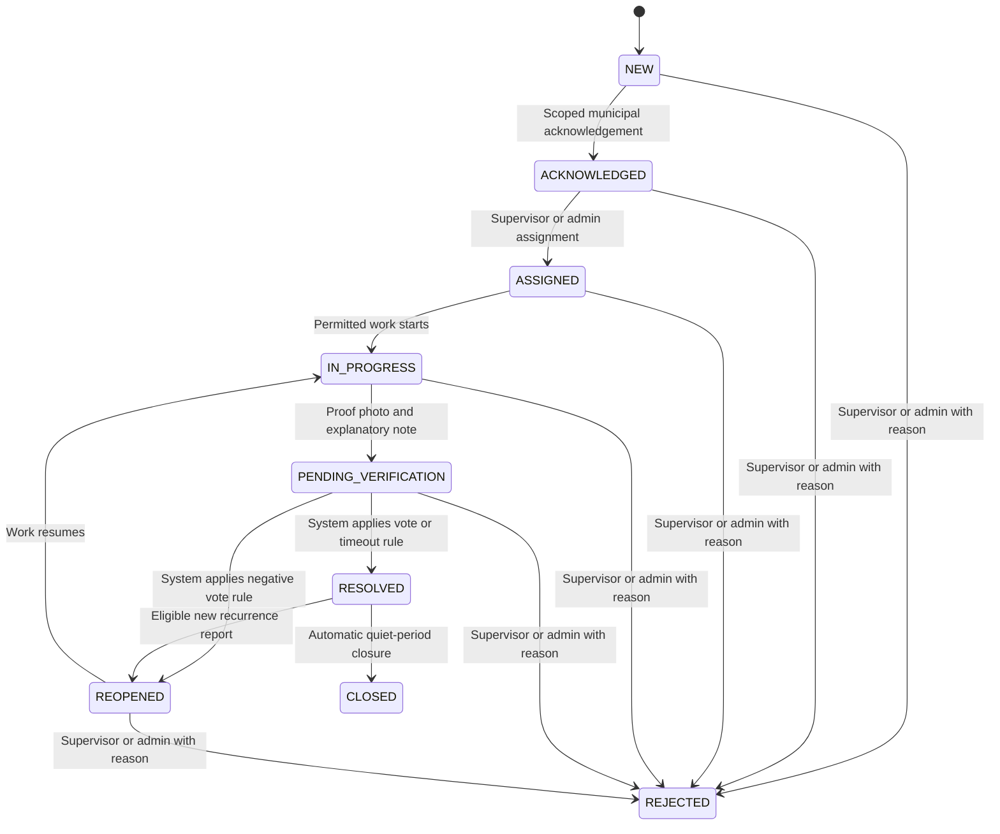
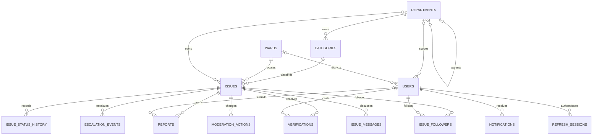

# NagrikSetu — Complete Project Documentation

**Deployed follow-up — 11 November:** application `6846b1b6bbb334db3eeec3dc2a40e7ea6a96ec39` is pushed;
[all CI jobs passed](https://github.com/vanshnanda08/NagrikSetu/actions/runs/42888337244), Vercel reports success, and password-only sign-in
works for all four live roles. [The deployed daily-use report](docs/DAILY_USAGE_VERIFICATION.md)
records 16 passing workflow groups and 30 layouts. QA complaint CT-2026-000919
completed real photo reporting, assignment, repair rejection/resubmission, citizen
confirmation, reasoned administrator closure and audit CSV export. Email recovery
remains deferred; physical-phone checks remain unavailable.

**Authentication scope, 10 November:** all roles now use password sign-in.
Authenticator enrollment, code challenges and mandatory MFA are retired by user
decision. [Local verification](docs/PASSWORD_AUTHENTICATION.md) passed 386 backend
tests (2 optional skips), 115 frontend tests, lint/types/build and 24 Security layouts.
Password/session controls and municipal role/scope restrictions remain. Historical
MFA descriptions in dated evidence are superseded for current implementation.

**Daily-use follow-up — 10 November:** [the latest rehearsal](docs/DAILY_USAGE_VERIFICATION.md)
records 20 passing workflow/continuity checks and 30 layouts, real hosted photos,
two citizen verification rounds and administrator closure in a disposable
environment. Fresh backend/frontend checks passed. A staff singular-count label
was corrected locally. This does not replace the report's explicit deployed
WebKit rapid-navigation limitation or physical-device boundaries.

**Last reviewed:** 2026-11-11 (Asia/Kolkata).<br>
**Repository:** `complaint-system`.  
**Original guide baseline:** `011ecb5` — “Record final cross-browser CI verification”, dated 2026-10-27.<br>
**Released application baseline:** `6846b1b6bbb334db3eeec3dc2a40e7ea6a96ec39`.<br>
**Review scope:** application source, configuration, migrations, tests, tools and dated verification evidence. Older audit/benchmark findings retain their original scope unless explicitly superseded.

**Verified release, 10 November:** the reviewed interface, workflow/audit fixes,
Patiala V11 and map changes are committed and pushed. Final
[CI passed all four jobs](https://github.com/vanshnanda08/NagrikSetu/actions/runs/42686876733),
and Vercel reports success. Live health and all four Patiala ward reads passed.
The explicitly approved synthetic complaint **CT-2026-000918** completed real
Cloudinary upload and report submission (201), followed by loaded photo/map,
desktop/mobile and evidence-dialog checks. Full backend: 381 passed, 2 optional
skips; frontend: 115 passed, lint, types and production build passed. The deploy
profile enforces the agreed email deferral. **Browser-only scope, agreed
10 November:** native Chrome/PWA installation and standalone installed-app checks
are excluded from completion requirements; previous attempts were unsuccessful.
Physical-phone browser checks remain unavailable. See
[release readiness](docs/RELEASE_READINESS.md) for exact evidence and boundaries.
The following dated pre-release notes record earlier states, not outstanding
uncommitted application work.

**Hosted recheck, 10 November:** API health returned 200 / UP after a
152.5-second cold start; subsequent database-backed reads and Vercel CORS passed.
The live ward names are still Ludhiana, so the local Patiala V11 update remains
unreleased. An invalid-photo probe confirmed the verification guard, without
creating a complaint; genuine deployed photo submission remains unverified.
See [release readiness](docs/RELEASE_READINESS.md) for the dated evidence.

**Latest follow-up, 8 November:** [release readiness](docs/RELEASE_READINESS.md)
records the local Patiala migration, map zoom/keyboard/detail fixes, explicit
email-recovery deferral, scheduler-test isolation and fresh checks. Backend:
379 passed, 2 optional skips. Frontend: 115 passed, lint, TypeScript and build
passed. Current production API probes time out; local results do not certify
the hosted service or physical-device behavior. Changes remain uncommitted.

The original guide used source inspection and local documentation checks. Subsequent runtime tests, audit fixes and release verification are linked with their dates and limits. The current release checks do not repeat the earlier academic benchmarks or establish municipal field suitability.

“Confirmed” below means supported by the inspected code or explicitly attributed repository evidence. **Not confirmed** marks something that cannot be established from those sources. Recommendations are suggestions, not promises or approved project plans. No private environment files or secret values are reproduced.

**Local implementation follow-up, 7 November:** escalation deadline/owner scope,
queue/assignment eligibility and expired-session reporting have since been fixed
and verified. See [workflow checks](docs/WORKFLOW_FIXES.md). Administrator closure
is also implemented, including reasoned early closure; see
[administrator verification](frontend/ADMIN_VERIFICATION.md). These are local
changes, not a new deployment or cloud-integration claim.

**Quality follow-up, 7–8 November:** [fresh local verification](frontend/QUALITY_VERIFICATION.md)
records short-message/verification wording fixes, real Cloudinary upload and
strict server evidence checks, service-worker outbox recovery, keyboard and basic
VoiceOver checks, and desktop/mobile layouts. The full backend suite passed 332
tests with two optional evaluations skipped; 115 frontend tests, lint, TypeScript
and build passed. Chrome's native installation did not complete, and no phone was
available for physical-device checks. The subsequent full role journey completed
in [the end-to-end audit](docs/END_TO_END_TEST_REPORT.md). Its five confirmed
defect categories are corrected in [audit follow-up fixes](docs/AUDIT_FIXES.md),
verified with 377 passing backend tests (2 optional skips), 115 frontend
tests, lint, TypeScript and build. Remaining browser/device test boundaries
are still explicit; no deployment or production sign-off is implied.

**Scope decision, 7 November 2026:** email notifications and email-based password
recovery are deferred to a future update at the user's request. Provider setup,
real email/reset-link delivery and associated live checks are excluded from the
current milestone. Existing code/routes and historical tests remain; in-app
notifications and signed-in password changes stay in scope.

## Contents

1. [Project Overview](#1-project-overview)
2. [How the Project Works](#2-how-the-project-works)
3. [Technologies Used](#3-technologies-used)
4. [Complete Folder and File Structure](#4-complete-folder-and-file-structure)
5. [Frontend Architecture](#5-frontend-architecture)
6. [Backend Architecture](#6-backend-architecture)
7. [Database and Data Management](#7-database-and-data-management)
8. [Features and Functionality](#8-features-and-functionality)
9. [Complete User Journey](#9-complete-user-journey)
10. [Current Development Progress](#10-current-development-progress)
11. [What We Are Currently Working On](#11-what-we-are-currently-working-on)
12. [Future Roadmap](#12-future-roadmap)
13. [Setup and Installation](#13-setup-and-installation)
14. [Important Technical Decisions](#14-important-technical-decisions)
15. [Known Problems and Limitations](#15-known-problems-and-limitations)
16. [Beginner-Friendly Glossary](#16-beginner-friendly-glossary)
17. [Quick Project Summary](#17-quick-project-summary)

## 1. Project Overview

### What are we building?

NagrikSetu is a municipal complaint reporting and tracking application. A resident reports a civic problem by choosing a category, attaching a photo and providing a location. Municipal staff receive a work item, respond to it, provide repair evidence and submit the claimed fix for verification. Anyone can inspect public complaints and city performance figures without an account.

The important distinction is between a **report** and an **issue**:

- A report is one observation: “I saw a pothole here”, with its own photo, position and time.
- An issue is the municipal work ticket for the underlying problem. It can contain many reports.

For example, five residents can report the same pothole. Instead of giving a crew five separate jobs, the application can group these reports into one issue. It preserves all five observations and uses the number of distinct reporters as one signal of urgency. Grouping is based on category, ward and geography; it does not understand the meaning of the photos or prove that two reports describe the same physical defect.

### What problem does it solve?

The implementation addresses duplicate complaints, unclear responsibility, missed response deadlines and fixes marked complete without a public record. It combines geographic grouping, role-based work queues, deadlines, escalation, repair photos, citizen feedback and public statistics.

Its value is the connected process. Reporting, assignment, proof, verification and public tracking refer to the same ticket and history. A resident can keep a reference such as `CT-2026-000431`, return later and see what happened.

### Users and responsibilities

| User | Main purpose | Important boundary |
|---|---|---|
| Guest / anonymous resident | Browse, track a reference and submit a report | Needs a device identifier to report; cannot cast verification votes |
| `CITIZEN` | Report while signed in, see personal reports, follow issues and answer verification requests | Can vote only on an issue they personally reported |
| `STAFF` | Acknowledge and work on complaints within their scope; submit repair proof | Normally must be the assignee to start assigned work or submit proof; cannot resolve or close |
| `SUPERVISOR` | Assign work, review grouping, moderate complaints and inspect team performance | Department/ward restrictions apply; see known scope inconsistencies in section 15 |
| `ADMIN` | City-wide work, policy/access configuration and audit/export | Configuration includes safeguards such as protecting the last active administrator |
| `SYSTEM` | Perform automatic verification outcomes, recurrence reopening and closure | Internal actor, not a public account-registration role |

The project is a substantial implemented prototype with academic evaluation artifacts. Repository evidence does not establish municipal field deployment, real-world service improvement or production capacity. The documented end-to-end goal is accountable civic reporting, from the first observation to a recorded outcome and public performance reporting.

The visible product name is **NagrikSetu**. The internal name **CivicTrack** remains in Java packages, property keys, database names, ticket prefixes, storage keys and deployment identifiers. These names do not identify separate applications.

## 2. How the Project Works

### The main parts



Next.js serves the web application and a few server-side proxy routes. Spring Boot owns civic business rules and database access. PostgreSQL stores the records; PostGIS adds geographic queries. Cloudinary stores photo files. Mail delivery is optional and separate from successful complaint processing.

### When someone opens the application

1. `/` redirects to `/dashboard` through `frontend/src/app/page.tsx`.
2. `frontend/src/app/layout.tsx` loads the common fonts, styles and providers.
3. `frontend/src/app/providers.tsx` creates the query cache, authentication state, sign-in dialog, draft composer and outbox synchronizer.
4. Authentication tries one silent refresh through `/api/auth/refresh`. With no refresh cookie, the handler returns 204, which means an ordinary anonymous visit.
5. Pages fetch the data they need. Public reads do not require login. Protected screens wait for authentication and check the current role.
6. Staff see a department overview at `/dashboard`; other roles use the public city dashboard. Work and administration are separate routes.

### When someone submits a report

1. The report form gets categories and asks for location. If GPS fails or is too inaccurate, the resident can place a pin manually.
2. The browser prepares the photo using `compressImage.ts` and extracts supported capture metadata using `exif.ts`. The draft can survive reloads through IndexedDB.
3. React Hook Form and Zod check category, coordinates, accuracy, photo presence and text limits.
4. The browser uploads the image directly to Cloudinary. The API receives the resulting URL, not a multipart photo file.
5. The form sends JSON to `POST /api/v1/reports`, with an `Idempotency-Key`. If signed in, it attaches an access token.
6. `ReportController` gets the reporter ID from the verified token, never from a user-supplied reporter field. `PhotoEvidenceService` checks the photo URL and computes a hash from fetched pixels when evidence verification is enabled.
7. `ReportSubmissionService` serializes account/device allowance checks, checks whether this submission already succeeded and applies report quotas.
8. `ClusteringService` validates category and ward, locks nearby work, then either creates an issue or attaches the report to an existing issue.
9. The transaction saves the report and updates issue geometry, counts, priority and deadline together.
10. The API returns HTTP 201 and a ticket result. Display labels are read after the transaction. The browser opens `/report/success/[ref]`; the receipt can recover its issue through a reference lookup after reload.



### How automatic grouping decides

`backend/src/main/java/com/civictrack/clustering/ClusteringService.java` implements incremental leader clustering: each arriving report is compared with an existing representative position, rather than repeatedly regrouping all old reports.

- Only appropriate same-category, same-ward candidates are considered. Closed/rejected issues are excluded; resolved issues are eligible only under the recurrence rules.
- A report's position receives weight `1 / max(accuracy, 3)²`. A smaller accuracy number means a more precise position and more influence on the average.
- The issue stores weighted coordinate sums, so adding one observation does not require rereading every member to calculate the centre.
- The effective radius is the category radius plus half the capped incoming accuracy and half the issue uncertainty. The default accuracy contribution cap is 60 metres; uncertainty is `1 / sqrt(sum of weights)`.
- Inside the effective radius, a merge is considered. Between that radius and 1.5 times it, the category chooses merge-and-flag or separate-and-flag. Further away, a new issue is created.
- A projected extent check can refuse even an otherwise nearby merge. This prevents a chain of reports from pulling one cluster along a long road.
- The selected decision and its distance/radius evidence are stored on the report.

The category table owns the policy numbers. Geography calculations in metres run in PostGIS. `CentroidMath.java`, `IssueRepository.java`, `ClusterProperties.java` and the migration files define the details. The algorithm is order-dependent; supervisor split/merge is its correction mechanism.

### From complaint to recorded outcome



This diagram follows the current `issue/policy/TransitionPolicy.java`. It does not include removed human-close functionality. Staff stop at `PENDING_VERIFICATION`; only the internal system can enter `RESOLVED` or `CLOSED` through this policy. Moderation also uses rejection to preserve a merged-away issue with a link to its surviving ticket.

## 3. Technologies Used

Versions below are repository declarations, not statements about the latest available releases. The reason column describes documented decisions or the role directly visible in code.

| Technology | What it does here | Where and how it connects |
|---|---|---|
| Java 21 | Backend language and build target; records provide small response/request objects | `backend/pom.xml`, Java source under `com.civictrack` |
| Spring Boot 3.5.16 | Starts the HTTP server and wires services, configuration and scheduled jobs | `CivicTrackApplication.java`, `application*.yml` |
| Spring Web and Bean Validation | Maps HTTP paths to controllers and checks request fields | Feature `api/` packages and request records |
| Spring Security OAuth2 Resource Server | Verifies bearer JWTs and enforces role checks | `config/SecurityConfig.java`, `user/auth/TokenSupport.java`; no handwritten JWT authentication filter |
| BCrypt / JWT | Protect passwords and issue signed access credentials | `user/auth/`; BCrypt cost 12, 15-minute access and 30-day refresh defaults |
| Spring Data JPA, Hibernate Spatial, JDBC | Read/write ordinary entities and execute spatial/aggregate SQL | Repositories, entities, dashboard queries and JDBC-backed security/configuration tables |
| PostgreSQL and PostGIS | Durable records plus ward containment, distances, map queries and spatial indexes | Local/test image `postgis/postgis:17-3.4`; hosted database described as Supabase |
| Flyway | Applies ordered database changes | SQL files in `backend/src/main/resources/db/migration/`, versions V1 through V10; Hibernate validates rather than creates the schema |
| ShedLock | Coordinates scheduled civic jobs through database locks | `config/SchedulingConfig.java`, `shedlock` table and job classes |
| Bucket4j | In-memory token buckets for login, registration and security attempts | `abuse/RateLimitService.java`; report-history checks provide separate durable report quotas |
| Actuator, Micrometer and Prometheus | Health probes, runtime metrics and ingest timing | `ObservabilityConfig.java`, `application.yml`; metrics require administrator access |
| springdoc-openapi | Generates API descriptions and Swagger UI from backend routes | `backend/pom.xml`; `/v3/api-docs`, `/swagger-ui/index.html` |
| Next.js 16.4.3 | Frontend routing, server rendering, build and small proxy handlers | `frontend/src/app/`, `next.config.ts` |
| React 19.2.8 and TypeScript | Interactive components and compile-time shape checks | `frontend/src/components/`, `src/lib/types.ts` |
| Tailwind CSS v4 and custom CSS | Utilities, colours, responsive layouts and scrolling panels | `postcss.config.mjs`, `src/app/*.css`; current interface is fixed light |
| TanStack Query | Caches server data, handles loading/errors and refreshes affected views | `providers.tsx`, `lib/queries.ts` and component queries |
| React Hook Form and Zod | Manage and validate reporting/proof forms before submission | `lib/schemas.ts`, report and work components |
| Leaflet | Interactive issue maps, evidence positions and manual pins | Only `components/map/MapCanvasInner.tsx` imports it; dynamically loaded by `MapCanvas.tsx` |
| Lucide React | Interface icons | Frontend components, alongside the project's status/category glyphs |
| IndexedDB, service worker and Web Locks | Persist drafts/jobs, retry queued reports and serialize supported browser operations | `offlineStore.ts`, `composer.tsx`, `public/report-worker.js`, `auth.tsx` |
| Cloudinary | Browser image upload, hosted evidence delivery, backend photo verification and orphan cleanup | `uploadPhoto.ts`, backend `media/`; browser unsigned preset does not contain the admin secret |
| SMTP or Brevo HTTPS | Optional email transport | `notification/MailDelivery.java`, `mail_outbox`; production delivery is deferred in project notes |
| Maven, npm and Docker | Dependency installation, compilation and reproducible backend/database packaging | Package files, lockfiles, Dockerfile and Compose |
| JUnit, Testcontainers and Vitest | Backend/PostGIS integration tests and frontend helper tests | Backend tests, frontend `*.test.ts`, Vitest config |
| Playwright | Running-app API/browser workflow and layout checks | `tools/`; separately installed npm project |
| Python, Matplotlib and k6 | Evaluation, saved-result summaries, plots and optional HTTP load measurements | `evaluation/`, `artifacts/evaluation/` |
| Render, Vercel and GitHub Actions | Recorded hosting targets, CI gates, deploy hook and operational workflows | Backend Dockerfile, `.github/workflows/`, deployment notes |
| LaTeX / IEEEtran / Tectonic | Academic manuscript, bibliography and figures | `paper/`; supporting deliverables, not application runtime dependencies |

## 4. Complete Folder and File Structure

This map covers the application's important source areas and supporting deliverables. Generated dependencies, build caches and individual screenshots are omitted because they are not authored application modules.

```text
complaint-system/
├── PROJECT_DOCUMENTATION.md          This guide
├── README.md                         Main entry point and running instructions
├── FINAL_AUDIT.md                     Dated release/security verification
├── docker-compose.yml                Local PostGIS service and persistent volume
├── .github/workflows/                CI, keep-alive and encrypted backup jobs
├── backend/
│   ├── pom.xml                       Backend dependencies, Java target and test setup
│   ├── Dockerfile                    Build, CDS training and runtime image stages
│   ├── .env.seed.example             Template used by remote seed/backup scripts
│   ├── ground_truth_labels.csv        Labelled synthetic reports for evaluation
│   └── src/
│       ├── main/java/com/civictrack/  Feature packages described below
│       ├── main/resources/
│       │   ├── application*.yml       Base, demo, deploy, seed and CDS profiles
│       │   └── db/migration/          V1–V11 SQL migrations and reference data
│       └── test/                     Unit/integration tests and test configuration
├── frontend/
│   ├── package.json, package-lock.json  Dependencies, scripts and locked versions
│   ├── .env.example                  Public/server API and photo configuration template
│   ├── next.config.ts                Redirects, browser security headers, bundler root
│   ├── eslint.config.mjs             Lint rules, including the Leaflet import boundary
│   ├── tsconfig.json, vitest.config.mts, postcss.config.mjs
│   ├── AGENTS.md, CLAUDE.md           Development guidance; not runtime modules
│   ├── SCREENS.md, *_VERIFICATION.md, DESIGN_RESTORATION.md
│   ├── public/
│   │   ├── report-worker.js           Background report delivery; no app asset cache
│   │   └── icons/                    Installable-app icons
│   └── src/
│       ├── app/                      Pages, layout, providers, styles and proxy routes
│       ├── components/               Reusable screen and interface components
│       └── lib/                      API/auth/state/photo/validation helpers and tests
├── tools/                            Independent Node/Playwright verification harnesses
├── scripts/                          Remote seed, backup and restore scripts
├── evaluation/                       Clustering, concurrency and latency workloads
├── artifacts/evaluation/             Retained CSV measurements and PDF charts
├── docs/                             Decisions, assessment, progress, reports, demo runbook
├── paper/                            Manuscript source, figures, evidence and QA scripts
├── prompts/                          Historical briefs and supplied project documents
└── MONTH-1-PROJECT-REPORT.pdf          Historical report
```

### Backend package responsibilities

All package names in this table are relative to `backend/src/main/java/com/civictrack/`.

| Package | Responsibility and connection |
|---|---|
| Root `CivicTrackApplication.java` | Application entry point; starts the Spring context |
| `report/` | One resident observation, submission/idempotency service, request/result records and intake controller; delegates grouping to `clustering/` |
| `clustering/` | Candidate selection, weighted geometry, confidence decisions and issue creation/merge; uses spatial repository SQL |
| `issue/` | Work-item entity, queries, lifecycle, priority and access guards; `api/` exposes work verbs; `policy/` declares transition rules; `board/` supplies supervisor assignment data |
| `sla/` | Deadline calculations and periodic sweeps; `escalation/` resolves owners and records idempotent escalation events |
| `verification/` | Eligible citizen views, per-round votes, quorum outcomes, timeout settlement and automatic closure |
| `moderation/` | Review queues, grouping confirmation, split/merge previews and commits, category/ward correction and description redaction |
| `publicapi/` | Separate anonymous-safe issue/report/history projections |
| `me/` | Current user's reports; identity always comes from authentication |
| `dashboard/` | Public city/ward/department aggregates, scoped staff overview and restricted team analytics |
| `stream/` | Server-sent event connections and dashboard-change notifications |
| `user/` | Users, roles, profile changes and preferences; `auth/` owns passwords and rotating tokens; `api/` exposes account routes |
| `category/`, `department/`, `ward/` | Reference records connecting defect policy, organization and geographic scope; category/ward read APIs |
| `notification/` | In-app notifications, unread/read actions and retrying mail outbox |
| `media/` | Photo URL/pixel verification, Cloudinary admin access and bounded orphan cleanup |
| `abuse/` | Quotas, login throttling, evidence screening and related refusals |
| `audit/` | Read-only combined event audit and safe CSV generation |
| `seed/` | Reproducible synthetic corpus and demo scenarios; refuses unsafe append/reset behavior |
| `config/` | Security, time, scheduling, metrics and administrator configuration endpoints |
| `common/` | Shared geographic construction, error responses and deterministic generation support |

### Important supporting files

`docs/DESIGN-DECISIONS.md` explains decisions and past failures. `docs/PROJECT_ASSESSMENT.md` records the November cleanup, reproduced gaps and proposed next work. `docs/PROGRESS.md`, `FINAL_AUDIT.md` and `docs/FINAL-PROJECT-REPORT.md` provide dated progress and results. `docs/DEMO-RUNBOOK.md` explains how to demonstrate the actual role sequence.

`frontend/SCREENS.md` is the current screen map. Citizen, public, staff, staff-overview, team-performance, density and ticket-detail verification notes describe the scope and limits of specific reviews. `frontend/SUPERVISOR_VERIFICATION.md` records the supervisor dry run, including its real-service and isolated-fixture boundaries.

Historical specifications in `docs/`, Word documents in `prompts/` and earlier reports describe requested or past work. They do not override current source behavior. `paper/README.md` identifies a manuscript baseline of commit `011ecb5`, so its diagrams and claims should not be treated as a complete description of later local interface changes.

## 5. Frontend Architecture

### Pages and screens

Paths in the implementation column are relative to `frontend/src/`.

| URL | What the user sees | Main implementation |
|---|---|---|
| `/` | Redirect to dashboard | `app/page.tsx` |
| `/dashboard` | City figures, charts, overdue work and anonymous ticket tracker; staff receive a scoped department overview | `app/dashboard/page.tsx`, `ComplaintTracker.tsx`, `work/StaffOverview.tsx` under `components/` |
| `/dashboard/wards/[id]` | Ward-specific public metrics | `app/dashboard/wards/[id]/page.tsx`, `components/ScopeOverview.tsx` |
| `/issues` and `?view=map` | Filtered issue list/map with shared URL state | `app/issues/page.tsx`, `components/ComplaintViews.tsx`, `components/complaints/` |
| `/issues/[id]` | Public summary, evidence/fix, location/grouping, history and eligible engagement | `app/issues/[id]/page.tsx`, `components/IssueDetailPanel.tsx`, `EvidencePhoto.tsx`, `IssueEngagement.tsx` |
| `/issues/[id]/cluster` | Read-only explanation of report membership and grouping evidence | `app/issues/[id]/cluster/page.tsx` |
| `/report` | Photo/category/location report composer and saved draft recovery | `app/report/page.tsx`, `components/PhotoUploader.tsx`, `lib/composer.tsx` |
| `/report/success/[ref]` | Receipt, grouping outcome and ticket link | `app/report/success/[ref]/page.tsx` |
| `/report/outbox` | Queued, failed and sent offline jobs with retry/removal | `app/report/outbox/page.tsx` |
| `/me/reports` | Current user's paginated reports and fixes awaiting a vote | `app/me/reports/page.tsx` |
| `/me/verify/[id]` | Before/after evidence, current round and fixed/not-fixed action | `app/me/verify/[id]/page.tsx` |
| `/me/notifications` | Paginated updates, unread counts and mark-read controls | `app/me/notifications/page.tsx` |
| `/me/settings` | Profile/preferences; `?tab=security` exposes password and signed-in device settings | `app/me/settings/page.tsx`, `components/account/` |
| `/login`, `/register` | Entry routes for a shared sign-in/registration dialog | Corresponding `app/` pages, `components/SignInDialog.tsx`, `lib/signInDialog.tsx` |
| `/forgot-password`, `/reset-password` | Request recovery and set a new password | Corresponding `app/` pages and `components/RecoveryForm.tsx` |
| `/work` | Shared complaints workspace; role determines permitted views | `app/work/page.tsx`, `components/work/ComplaintsShell.tsx` |
| `/work?view=mine` | Scoped queue and selected work/proof panel | `components/work/WorkQueue.tsx`, `WorkIssuePanel.tsx`, `AssigneePicker.tsx` |
| `/work?view=assignments` | Supervisor/admin assignment board and selected complaint | `components/supervisor/AssignmentPanel.tsx` |
| `/work?view=review` | Supervisor/admin flagged grouping review | `components/supervisor/ReviewPanel.tsx` |
| `/work?view=performance` | Restricted team totals, crew records, trends and backlog | `components/supervisor/AnalyticsPanel.tsx` |
| `/supervisor/issues/[id]` | Contextual moderation, including category/ward/redaction/rejection actions when allowed | `app/supervisor/issues/[id]/page.tsx` |
| `/supervisor/issues/[id]/cluster` | Split/merge selection, preview and commit | `app/supervisor/issues/[id]/cluster/page.tsx`, `lib/moderation.ts` |
| `/admin` and `?view=audit` | Configuration and audit/export tabs | `app/admin/page.tsx`, `components/admin/ConfigurationPanel.tsx`, `AuditPanel.tsx` |

Legacy routes redirect in `frontend/next.config.ts`: `/map` becomes the map view of `/issues`; profile/security become settings tabs; staff queue/detail and supervisor queue/review/analytics become `/work` views; old admin pages become `/admin` tabs. The supervisor moderation and cluster pages remain real contextual pages. Query parameters preserve selected complaint and queue context where supported.

### Components and presentation rules

`PageShell`, `WorkspaceShell`, `SiteHeader` and `SectionTabs` supply shared page/navigation structure. `Button`, `TextField`, `LoadingState`, `EmptyState`, `ErrorState` and `Skeleton` provide common interaction states. `IssueRow`, `TicketRef`, `PriorityBadge`, `StatusRule` and `DeadlineCountdown` keep complaint summaries consistent.

`lib/status.ts` supplies the status words, glyphs and colours. Status is shown with shape and text as well as colour. Charts in `components/charts/` include table alternatives. `EvidencePhoto`, `Photo` and related components supply evidence display and failed-photo handling; full-size evidence dialogs preserve access to the underlying images.

The current layout uses one light appearance. `globals.css` and the additional `committed-light.css`, `civic-interface.css`, `viewport-layout.css`, `dashboard.css`, `team-performance.css` and report CSS control the current layout. Old dark/glass-theme claims in historical notes are not descriptions of the current providers/layout. At desktop sizes described in the screen notes, long panels scroll internally; phones and short windows use normal page flow. Physical-device behavior is not newly verified by this guide.

### State and data flow

| State | Owner | Why it exists |
|---|---|---|
| Server records and loading/error state | TanStack Query | Reuse results and refresh after writes |
| Access token and signed-in user | `lib/auth.tsx` React context | Keep credentials in memory and supply authenticated requests |
| Refresh credential | HttpOnly cookie set by Next handlers | Renew access without exposing the refresh token to browser JavaScript |
| Report draft | `lib/composer.tsx` plus IndexedDB | Retain text, location and photo across navigation/reload |
| Submitted offline jobs | `lib/offlineStore.ts`, service worker | Retry only reports explicitly queued by the user |
| Filters, selected view/issue, queue page, map position | URL parameters and navigation helpers | Support bookmarks, Back navigation and restored queue context |
| Form inputs and local dialogs | React state / React Hook Form | Handle temporary interaction before an API write |

`lib/api.ts` builds JSON requests, attaches bearer tokens and preserves server problem responses in `ApiError`. `API_BASE` is used on the Next server; `NEXT_PUBLIC_API_BASE` is used in the browser. Ordinary civic requests go directly to Spring; auth-cookie operations and offline delivery use Next route handlers.

`lib/queries.ts` normally keeps list data fresh for 30 seconds, treats category/ward reference data as indefinitely fresh and treats issue detail as immediately stale. Dashboard polling uses 60 seconds. SSE change events invalidate summary and breaching data; they do not replace the API response with a second independently defined metric.

Authenticated reads/mutations commonly use `authed()`, which refreshes and retries once on 401. Sign-in/out clears cached user data, and personal query keys include the user ID. Online report submission also uses this wrapper and binds retries to the draft's original account and submission key. Failed renewal or a changed account leaves the draft intact for in-place sign-in and retry.

### Offline reporting boundaries

The `civictrack-offline` IndexedDB database contains `drafts` and `outbox`. An outbox job stores its submission ID, original account, payload, photo blob, upload configuration, retry state and eventual reference. It does not store access or refresh tokens. There is a limit of 30 unsent jobs.

The worker uploads any missing photo, then calls Next `/api/offline-report`. For an account-owned job, that route renews the cookie session and checks that the returned user matches the job owner. It forwards the same submission ID as the backend idempotency key. Successful jobs clear their local photo and location payload. Network/server failures back off; most 4xx refusals require user intervention, while 429 can retry.

Background Sync depends on browser support. `OutboxSync.tsx` also wakes queued work when the app is available. The worker explicitly has **no application asset cache**, so saving a draft does not guarantee a fresh offline reload can open every page.

## 6. Backend Architecture

### Server organization and request handling

The server is a single Spring Boot application, organized by feature rather than split into independently deployed services. A controller translates an HTTP request into a service call. A service applies business rules and controls a database transaction. Repositories/JDBC queries read and write records. DTOs—small response/request records—keep API shapes separate from database entities.

A protected work request follows this path:

1. Spring Security verifies the bearer token signature, issuer, expiry and access-token type.
2. URL rules establish whether authentication is required. `@PreAuthorize` checks the role and, where relevant, issue scope.
3. Bean Validation checks the request body.
4. `IssueLifecycleService` loads the issue and builds a transition context.
5. `TransitionPolicy` checks whether the state change exists, whether this role may request it and whether its named guards pass.
6. `IssueStatusService` accounts for the clock, changes status, applies side effects, writes history and publishes an event.
7. Related notification writes occur in the same transaction. Refusal rolls back civic changes.
8. The controller returns a DTO; the frontend refreshes affected records and queues.

This backend does not have an Express-style middleware directory. **Not applicable:** Node middleware architecture. Equivalent cross-cutting functions are Spring Security's filter chain, method guards, validation, transactions and `GlobalExceptionHandler`/`SecurityProblemHandlers`.

### API directory

All paths in the table have prefix `/api/v1`. An `{id}` is normally a UUID, while `{publicRef}` is a human-facing ticket reference. A UI URL and backend API URL are different things.

| Method and path | Purpose / access | Controller location under `com/civictrack/` |
|---|---|---|
| GET `/categories`, `/wards` | Public reference data | `category/api/CategoryController.java`, `ward/api/WardController.java` |
| POST `/reports` | Anonymous or authenticated intake; optional UUID `Idempotency-Key` | `report/api/ReportController.java` |
| GET `/public/issues` | Public filtered list; `status`, `category`, `ward`, `sort`, `limit`, `offset` | `publicapi/PublicIssueController.java` |
| GET `/public/issues/bbox` | Map rectangle: `south`, `west`, `north`, `east`, optional status/category | Same controller |
| GET `/public/issues/{id}`; `/public/issues/by-ref/{publicRef}` | Public detail or reference lookup | Same controller |
| GET `/public/issues/{id}/reports`; `/history` | Public evidence and status history | Same controller |
| GET `/dashboard/summary`, `/departments`, `/metrics`, `/breaching`, `/wards/{id}` | Public aggregate views | `dashboard/DashboardController.java` |
| GET `/stream/dashboard` | Public SSE connection | `stream/StreamController.java` |
| POST `/auth/register`, `/login`, `/refresh`, `/logout` | Citizen registration, login and credential lifecycle | `user/api/AuthController.java` |
| POST `/auth/forgot-password`, `/reset-password` | Recovery request and one-use reset | `user/api/RecoveryController.java` |
| GET `/me/reports` | Current user's paged observations | `me/MyReportsController.java` |
| GET `/me/verifications`, `/me/verifications/{id}` | Current user's verification views | `verification/api/VerificationController.java` |
| POST `/issues/{id}/verify` | Original citizen reporter's current-round vote | Same controller |
| GET `/me/notifications`, `/unread-count`; POST `/me/notifications/read` | Own updates/count and mark selected/all read | `notification/api/NotificationController.java` |
| GET/PUT `/me/profile`; POST `/me/password` | Profile/preferences and password change | `user/api/ProfileController.java` |
| GET/PUT `/me/email-preferences` | Own optional email setting | `user/api/EmailPreferencesController.java` |
| GET `/me/security` | Compatibility status; retired enrollment paths return 410 | `user/api/AccountSecurityController.java` |
| GET `/me/security/sessions`; DELETE `/me/security/sessions/{familyId}`; POST `/me/security/sessions/revoke-others` | Own refresh-session families | Same controller |
| GET `/staff/queue` | Scoped municipal queue, with tab/limit/offset | `issue/api/StaffQueueController.java` |
| GET `/staff/overview` | Staff-only department and personal work totals/previews | `issue/api/StaffOverviewController.java` |
| GET `/issues/{id}` | Protected municipal detail | `issue/api/IssueController.java` |
| POST `/issues/{id}/acknowledge`, `/assign`, `/start`, `/submit-for-verification`, `/reject` | Guarded work verbs; assignment/rejection require supervisor/admin | Same controller |
| GET `/supervisor/queue`, `/departments/{departmentId}/members` | Assignment board and crew picker | `issue/board/AssignmentBoardController.java` |
| GET `/supervisor/review` | Paged grouping review | `moderation/api/SupervisorController.java` |
| POST `/supervisor/issues/{id}/confirm`, `/split/preview`, `/split`, `/merge/preview`, `/merge` | Confirm or preview/commit membership correction | Same controller |
| POST `/supervisor/issues/{id}/recategorise`, `/reassign-ward` | Correct category or geographic responsibility | Same controller |
| GET `/supervisor/issues/{id}/ward-options`, `/moderation` | Allowed wards and moderation history | Same controller |
| POST `/supervisor/issues/{id}/reports/{reportId}/redact` | Hide public description while retaining original | Same controller |
| GET `/supervisor/analytics` | Restricted department/team analysis | `moderation/api/AnalyticsController.java` |
| GET/POST/DELETE `/issues/{issueId}/follow` | Citizen follow state and changes | `issue/api/IssueEngagementController.java` |
| GET/POST `/issues/{issueId}/messages` | Private clarification for reporter/scoped municipal participants | Same controller |
| GET `/admin/audit`, `/admin/audit.csv` | Admin event browsing and bounded CSV export | `audit/AuditController.java` |
| GET `/admin/configuration`, `/admin/configuration/audit` | Admin existing configuration and its history | `config/AdminConfigurationController.java` |
| PUT `/admin/configuration/categories/{code}`, `/users/{id}`, `/departments/{id}`, `/wards/{id}` | Audited existing-record edits | Same controller |

Outside this prefix, `/actuator/health` and health probes are public. Metrics/Prometheus require `ADMIN`. Swagger/OpenAPI is publicly permitted. Next's `/api/auth/*` and `/api/offline-report` are frontend server handlers, not Spring controllers.

Public and staff queues clamp page sizes to at most 200. Public map queries return at most 500 issues and a `capped` flag; the client can ask the user to zoom rather than imply all results are shown. Review and notification APIs cap pages at 100. Audit pages cap at 200 and a CSV export at 50,000 rows. See the controller constants for the current authoritative limits.

### Authentication and authorization

Self-registration creates `CITIZEN` only. Password policy and BCrypt hashing live on the server. Access and refresh JWTs have different type claims; the resource server accepts only access tokens. Refresh token hashes and family state live in `refresh_sessions`. Refresh consumes a token, rotates it and rereads the current user. Reusing a consumed/revoked credential revokes its family.

The browser receives refresh credentials only as an HttpOnly, SameSite=Lax cookie; it is Secure in production. Next handlers check origins around cookie operations. `auth.tsx` shares an in-flight refresh and uses Web Locks where available to coordinate tabs.

All roles use password authentication. Authenticator enrollment, one-time-code login checks and municipal MFA requirements were removed on 10 November at the user's request. Password hashing, role/department/ward guards, access-token validation, refresh rotation and session revocation remain. Existing enrollment columns and migration V10 are retained as inert historical schema; compatibility status fields report false/zero and retired enrollment routes return 410.

Role checks alone are insufficient. `IssueAccessGuard` allows administrators city scope, supervisors matching department **or** ward scope, and staff matching department plus an optional ward restriction. `Guards.IS_ASSIGNEE` supplies per-transition ownership checks. `REOPENED → IN_PROGRESS` deliberately has no assignee guard in the current transition table. See section 15 for gaps between these rules and queue/escalation/assignment paths.

### Business rules: urgency, deadlines and verification

Priority is calculated in `issue/PriorityCalculator.java`:

```text
score = category severity
      + 12 × log2(1 + distinct reporters)
      + 0.15 × age in hours after accumulated pause credit
      + 20 × escalation level
      + 15 × reopen count

LOW: score < 25
MEDIUM: 25 ≤ score < 50
HIGH: 50 ≤ score < 80
CRITICAL: score ≥ 80
```

Account IDs or anonymous device identities contribute to distinct-reporter counting; this is not proof of unique human residents. Following does not count as reporting. The logarithm limits the benefit of very large report counts.

`SlaService` scales category hours by priority: critical 0.25, high 0.5, medium 1.0 and low 1.5. Initial allowance is measured from the first report. Effective deadline is stored `due_at + paused_seconds`; breach also requires a clock-running status. Time waiting for verification is paused. Priority updates can tighten deadlines, with a known interaction with escalation rearming noted in section 15.

Escalation walks department head → parent department head → ward officer → administrator, capped at level four. Each level receives a rearmed allowance based on the full priority-scaled allowance divided by `2^level`, with a two-hour production floor. The database prevents duplicate `(issue_id, level)` records. `EscalationService`, `LadderResolvers`, `SlaSweepService` and `PriorityRecomputer` implement this behavior.

For verification, submitting a new repair increments the issue's round. Required confirmations are `min(3, max(1, ceil(distinct reporters / 2)))`. Each `CITIZEN` who originally reported the issue can vote once per round. A comment is optional, limited to 280 characters by `VerifyRequest`, and retained only for a negative verdict. This differs from a municipal rejection or repair submission, where a minimum-length explanation is required.

- At least one rejection that ties or exceeds confirmations reopens the issue; this condition is checked first.
- Enough confirmations resolve it.
- At the default 72-hour timeout, no rejection or a positive majority can resolve it even without the full quorum.
- Zero votes at timeout resolve it with `resolved_without_verification=true`.
- A seven-day quiet period after resolution permits automatic closure. Eligible recurrence can reopen a resolved issue before it closes; closed issues are not merge targets.

These are actual code rules in `VerificationTally`, `VerificationService` and `VerificationQuorumService`. “Resolved” therefore does not always mean citizens confirmed a repair.

### Jobs and event delivery

| Job/event | Default behavior | Main files |
|---|---|---|
| SLA sweep | Every five minutes: escalate breached work and recompute priority | `sla/SlaEscalationJob.java`, `SlaSweepService.java` |
| Verification sweep | Every five minutes: settle expired rounds and auto-close eligible resolved issues | `verification/VerificationSweepJob.java`, `VerificationSweepService.java` |
| Mail delivery | Poll every 30 seconds, process at most 10 pending messages per batch, retry up to eight attempts | `notification/MailDelivery.java` |
| Orphan photo sweep | Configured nightly; considers old unreferenced assets, default minimum age 24 hours and maximum 200 deletions | `media/CloudinaryOrphanJob.java`, `CloudinaryOrphanSweep.java` |
| Status event | History and reporter/follower notification creation linked to the transition transaction | `issue/IssueStatusService.java`, `notification/NotificationService.java` |
| Dashboard stream | Coalesced change signals cause client API refetches | `stream/DashboardStream.java`, `lib/queries.ts` |

The seed profile disables SLA, verification and orphan schedules to avoid changing the deterministic corpus while it is produced. Mail has its own enable flag and polling behavior; seed is not a blanket switch disabling every scheduled method. Cloudinary deletion defaults to dry-run and requires admin credentials even to operate against real assets.

### Errors

`common/error/GlobalExceptionHandler.java` returns structured `ProblemDetail` responses with a status, message and often a stable problem type or extra field. Typical outcomes are 400 for malformed/invalid input, 401 for missing/invalid credentials, 403 for forbidden access, 404 for missing public resources, 409 for state/guard conflicts, 422 for unusable position/photo evidence and 429 with `Retry-After` for throttling. Unexpected failures are logged server-side and return a generic 500 response.

`config/SecurityProblemHandlers.java` covers failures before controller execution. The frontend keeps the server's problem message rather than replacing every refusal with a network error. Some invalid inputs outside typed DTO validation can still fall into broader error handling; message validation is one example in section 15.

## 7. Database and Data Management

### Database and schema ownership

The database is PostgreSQL with PostGIS, `pgcrypto` and `btree_gist`. Flyway owns schema changes. Hibernate uses `ddl-auto: validate`, so it checks that entity mappings match the schema rather than silently altering tables. There is no H2 fallback for spatial integration tests.

Spatial points use SRID 4326, the usual latitude/longitude coordinate system. `GeoFactory` centralizes point construction: geometry X is longitude, Y is latitude. PostGIS geography casts provide metre-based distances. Composite/partial GiST indexes support the category/ward/distance candidate query. Other indexes support due work, report ownership, review lists, notifications and history.

### Tables and their meaning

| Table | Important data and relationships |
|---|---|
| `departments` | Organizational code/name, optional parent department and head user |
| `wards` | Ward number/name, polygon boundary and officer user |
| `categories` | Defect code/name, merge radius, SLA hours, severity, recurrence window, extent multiplier, low-confidence rule, active flag and department |
| `users` | Contact/name, password hash, role, department/ward scope, active state, notification settings and MFA fields |
| `issues` | Stable UUID/public reference, category/ward/department, state, assignment, priority, weighted geometry, counts, clock fields, repair evidence, verification round and merge target |
| `reports` | Parent issue, optional reporter and device identity, point/accuracy, photo URL/hash, text, capture time, grouping decision/measurements, screening and redaction metadata |
| `issue_status_history` | From/to state, actor role/ID, note and time |
| `escalation_events` | Issue, level, old/new owner, reason and timing; unique issue/level |
| `verifications` | Issue, citizen, round, verdict, comment and time; unique issue/round/citizen |
| `notifications` | User-specific issue updates, text and read time |
| `moderation_actions` | Actor/action/issue, related issue and JSON details of corrections |
| `configuration_audit` | Administrator, resource and JSON before/after values |
| `refresh_sessions` | Hashed refresh credentials, family, expiry, consumption, revocation and MFA/session timestamps |
| `password_resets` | Hashed reset credentials, expiry and use time |
| `mail_outbox` | Recipient, subject/body, retry count, next attempt and sent state |
| `report_submissions` | Identity-bound submission key, payload hash and saved result for safe retries |
| `mfa_recovery_codes` | Inert legacy table retained with applied V10; no current authentication code reads it |
| `issue_followers` | Issue/user relationship; independent of report counts |
| `issue_messages` | Private issue thread, author role, request/reply kind, text and time |
| `shedlock` | Scheduler lease names, owners and expiry |



This diagram shows the main relationships, not every foreign key. For example, issues also refer to assignees, repair submitters and surviving merged issues; departments/wards refer to responsible users.

### Migration history

| Migration | Change |
|---|---|
| V1 | Extensions, core/reference/workflow tables, constraints and indexes |
| V2 | Department tree, four approximate Ludhiana wards and ten categories |
| V3 | Changes water-leak low-confidence policy to `SPLIT_FLAG` |
| V4 | Seeded organization accounts and responsibility links |
| V5 | Verification rounds, per-round uniqueness and settlement indexes |
| V6 | Merge-target preservation and moderation action log |
| V7 | Notification preferences, ward reassignment action and audit indexes |
| V8 | Capture/screening/redaction fields and photo-hash indexes |
| V9 | Refresh sessions, resets, email preference/outbox, configuration audit and report idempotency |
| V10 | MFA/session metadata, recovery codes, followers and private messages |
| V11 | Moves the four illustrative ward sectors to Patiala near Thapar; preserves ward IDs, officer assignments and historical issue/report coordinates |

V2 originally defined a demonstration grid around Ludhiana. V11 relocates those
four illustrative sectors to longitude 76.286–76.446 and latitude 30.296–30.416
near Thapar Institute, Patiala. They are not official municipal boundaries.
Existing complaint coordinates remain unchanged. Locations outside the configured
polygons are refused; exact boundary-edge behavior follows the containment query.
Do not edit applied migrations or move historical complaints to fit new polygons.

### Initial category policy

These are migration defaults after V3, not a fresh read of any running database. Administrator edits can change them. Base SLA hours are further scaled by issue priority; they are not a promise that every ticket gets the listed number of hours.

| Code | Department | Radius (m) | Base SLA (hours) | Severity | Reopen window (days) | Extent multiplier | Ambiguous match |
|---|---|---:|---:|---:|---:|---:|---|
| `POTHOLE` | Roads | 25 | 72 | 15 | 14 | 2.0 | Merge and flag |
| `ROAD_DAMAGE` | Roads | 60 | 120 | 12 | 14 | 2.5 | Merge and flag |
| `SIGNAGE` | Roads | 20 | 168 | 6 | 14 | 2.0 | Merge and flag |
| `STREETLIGHT` | Electrical | 30 | 96 | 10 | 14 | 2.0 | Merge and flag |
| `GARBAGE_DUMP` | Sanitation | 50 | 48 | 12 | 14 | 2.0 | Merge and flag |
| `ILLEGAL_DUMPING` | Sanitation | 50 | 48 | 14 | 14 | 2.0 | Merge and flag |
| `WATER_LEAK` | Water | 40 | 24 | 20 | 14 | 2.0 | Separate and flag |
| `DRAINAGE_BLOCK` | Water | 40 | 24 | 18 | 14 | 2.0 | Merge and flag |
| `OPEN_MANHOLE` | Water | 20 | 6 | 40 | 14 | 1.5 | Separate and flag |
| `STRAY_ANIMAL` | Animal Control | 120 | 24 | 16 | 3 | 2.0 | Separate and flag |

The extent cap is radius × extent multiplier. `is_mobile_target` and user `reputation` remain stored legacy fields; their presence does not establish moving-target tracking or reputation-based scoring. The ineffective mobile-target admin control was removed without deleting its stored values.

### Creating, reading, updating and retaining data

Reports are created through the submission transaction. Public reads use dedicated projections that omit reporter/device/hash identity fields. Municipal reads expose the work information needed for permitted actions. Updates go through lifecycle, moderation, profile or configuration services.

Reports are retained when grouping is corrected: split/merge changes membership, not the report's photo, identity or original automatic decision. Redaction hides public description text while retaining the source and an audit. A merged-away issue remains addressable and points to the surviving issue. There is no ordinary user-facing complaint/report deletion workflow in the inspected API.

“Immutable evidence” is an architectural retention intention, not a database-wide guarantee that no report column can change: membership and redaction metadata do change, and a database operator still has database privileges. Similarly, audit logs are append-oriented application records, not cryptographically tamper-proof storage.

Database transactions and locks protect multi-record changes. Issue entities also use an optimistic version. Submission idempotency detects reuse of the same key with a different payload and returns conflict. Photos live outside the database; tables store their URLs and hashes. Browser IndexedDB is local storage and is not included in database backups.

## 8. Features and Functionality

“Completed” in this section means an implemented application path supported by code and the repository's relevant test/verification material. It does not mean this review tested every environment. Features with operational gaps are marked separately.

| Feature | Why it exists and how the user uses it | Internal implementation / source | Status |
|---|---|---|---|
| Anonymous and signed-in reporting | Lets residents report without registration and optionally link observations to an account | `app/report/page.tsx`; backend `report/api/ReportController.java`, request validation and `ReportSubmissionService.java` | Completed; real-photo setup required |
| GPS and manual location | Helps crews find problems and recover from poor GPS | `lib/useGeolocation.ts`, `MapCanvas.tsx`, `lib/schemas.ts`; backend ward/accuracy checks | Completed; only configured service area |
| Photo preparation/upload | Reduces upload size and provides visual evidence | `compressImage.ts`, `exif.ts`, `uploadPhoto.ts`, `PhotoEvidenceService.java` | Completed code; current live integration Unknown |
| Safe repeated submission | Avoids a second report when the first succeeded but the reply was lost | Stable UUID in composer/worker; `report_submissions` payload/result record | Completed; same key cannot represent an edited payload |
| Incremental geographic grouping | Turns nearby same-type observations into one job | `ClusteringService.java`, `CentroidMath.java`, `IssueRepository.java` | Completed; known geographic/order limitations |
| Review flags and screening | Makes uncertain grouping or suspicious evidence visible to supervisors | `ContentScreeningService.java`, report abuse fields, review queue | Completed rule-based screening; not general AI fraud detection |
| Public ticket lookup | Lets an anonymous resident return using a reference | `ComplaintTracker.tsx`, `TicketSearch.tsx`, `/public/issues/by-ref/{publicRef}` | Completed |
| Public list/map/detail/history | Lets everyone inspect progress and evidence | `ComplaintViews.tsx`, `components/complaints/`, issue pages, `PublicIssueController.java` | Completed; map cap disclosed |
| Grouping inspector | Explains which reports joined and why | Public cluster page, stored report decisions, moderation helpers | Completed |
| Scoped work queue | Helps crews find their work without crossing department boundaries | `WorkQueue.tsx`, `StaffQueueController.java`, `IssueLifecycleService.java` | Completed; current 50-row UI pagination and missing-scope denial |
| Staff department overview | Separates personal workload from departmental totals | `work/StaffOverview.tsx`, `StaffOverviewService.java`, `/staff/overview` | Completed local implementation; totals are independent of six-row previews |
| Acknowledgement, assignment and work | Records who accepted and performed a repair | `WorkIssuePanel.tsx`, `AssignmentPanel.tsx`, `IssueController.java`, `TransitionPolicy.java` | Completed; remaining assignment/scope gaps in section 15 |
| Repair proof | Requires an uploaded image and at least 20 characters explaining the work | `lib/repairProof.ts`, work panel, `ResolveRequest.java`, `IssueStatusService.java` | Completed; current UI refuses placeholder proof and preserves failed-upload inputs |
| SLA and priority ageing | Makes neglected or widely reported work more urgent | `PriorityCalculator.java`, `SlaService.java`, `PriorityRecomputer.java`, sweeps | Partially completed end-to-end consistency; rearm gap remains |
| Automatic escalation | Moves overdue responsibility through the organization | `sla/escalation/`, unique issue/level records and scheduler locking | Local deadline/owner-scope regressions passed; operational scheduler checks remain separate |
| Citizen repair verification | Lets original citizen reporters challenge a claimed fix | Verification page, `VerificationService.java`, `VerificationTally.java`, V5 | Completed rules; anonymous participation and timeout limitations |
| Automatic closure and recurrence | Settles quiet resolved work and reopens eligible recurrence | `VerificationSweepService.java`, `ClusteringService.java`, system transitions | Completed; human-close API removed |
| Notifications and preferences | Keeps signed-in reporters/followers informed | Notifications page, `NotificationService.java`, profile/preferences components | Completed; mandatory verification-request behavior is separately enforced |
| Following | Lets citizens receive updates without submitting another report | `IssueEngagement.tsx`, `IssueEngagementService.java`, `issue_followers` | Completed; does not increase priority or grant a verification vote |
| Private clarification | Lets original signed-in reporters answer municipal requests for details | `IssueEngagement.tsx`, messages API/table and participant checks | Completed; thread is not part of public report/history DTOs |
| Supervisor grouping correction | Confirms, splits or merges uncertain groups without losing observations | `ReviewPanel.tsx`, supervisor cluster page, `ModerationService.java`, `ClusterRecomputer.java` | Completed; membership edits limited to allowed work states |
| Category/ward correction and redaction | Corrects routing mistakes or removes sensitive public description text | Supervisor moderation page, corresponding backend moderation verbs | Completed; category correction only before assignment, ward distance guard defaults to 300 m |
| Public accountability dashboard | Shows backlog, response/compliance trends, reopening and unverified outcomes | Dashboard page, chart components, `dashboard/` SQL/services | Completed; metrics with too little evidence are withheld |
| Live dashboard | Refreshes time-sensitive figures after changes | `DashboardStream.java`, `StreamController.java`, `useDashboardStream()` | Completed; SSE signal plus normal reads/polling |
| Team performance | Gives supervisors scoped crew/trend/backlog views | `AnalyticsPanel.tsx`, `DepartmentAnalyticsService.java`, `StaffAnalyticsQueries.java` | Completed; restricted separately from public department data |
| Profile and password maintenance | Lets users update their own details/preferences and change passwords | `components/account/`, `ProfileService.java`, password policy | Completed |
| Password sign-in and rotating sessions | Authenticates users and lets them revoke sessions | `auth.tsx`, auth proxy routes, `AuthService.java`, security controller | Completed; issued access-token revocation is not immediate |
| Password recovery and opt-in email | Existing recovery/outbox code retained for a later release | `PasswordRecoveryService.java`, `MailDelivery.java`, `mail_outbox` | Deferred to a future update by user decision; not a current completion requirement |
| Administrator configuration | Edits existing category policy, user access and organization responsibility | `ConfigurationPanel.tsx`, `AdminConfigurationController.java`, audit table | Completed for existing records; new-record provisioning Not implemented |
| Event audit and CSV | Supports accountability/review across transitions, escalations and moderation | `AuditPanel.tsx`, `AuditQueries.java`, `AuditCsv.java` | Completed; bounded export |
| Persistent drafts/outbox | Preserves work on weak connections and retries explicit offline submission | `composer.tsx`, `offlineStore.ts`, worker and Next offline route | Completed implementation; full offline navigation Not implemented |
| Optional installation support | Existing manifest/icons and browser install entry point retained | `app/manifest.ts`, `PwaInstall.tsx`, public icons | Installation/standalone-app verification excluded from browser-only scope by user decision, 10 November |
| Media orphan cleanup | Finds uploaded images abandoned before report submission | `CloudinaryOrphanSweep.java`, admin client and job | Completed dry-run implementation; enabling deletion is Planned after review |
| Deployment, CI and backups | Builds releases and preserves database records | Dockerfile, workflows, `scripts/backup.sh`, `restore.sh` | Completed tooling; current hosted state Unknown |
| Academic evaluation | Measures grouping quality, chain behavior, scale and concurrency | `evaluation/`, opt-in backend tests, retained CSV/PDFs | Completed retained experiments; generalization Not confirmed |

## 9. Complete User Journey

### A resident reports a pothole and checks the repair

This is an illustrative journey through implemented behavior, not a claim that these exact residents or events occurred.

1. A resident opens the dashboard and can see public figures immediately. They choose **Report a problem**. Signing in first is useful if they want the issue in My reports and want to vote on its repair.
2. They choose Pothole, attach a photo and allow location access. For a demo outside the configured Patiala sectors, they use a manual pin inside a configured ward. The browser retains the draft and checks the form.
3. They submit. The photo uploads first; the backend verifies it, enforces quotas and decides whether this report belongs to existing work. The response gives a public reference.
4. Another resident/device reports the same category nearby. If radius, ward, extent and status rules allow, the second report joins the same issue. Both photos remain. Distinct-reporter count and priority can increase.
5. The supervisor sees the issue in Assignments, acknowledges it if still new and assigns the acknowledged ticket to a department crew member. This is an actual required role handoff: crew cannot assign themselves through the assignment endpoint.
6. The assigned crew member opens My work, starts the job, carries out the physical repair outside the app and submits a hosted proof photo plus a meaningful note. The app records the actor/history and starts a new verification round. The SLA clock pauses.
7. The signed-in citizen reporter receives a notification, opens the verification screen and compares evidence. They choose fixed or not fixed. The backend confirms their reporter relationship and refuses a second vote in the same round.
8. Enough positive votes resolve the issue. A prevailing negative vote reopens it and increases its reopen/escalation counters. The crew can return to work and create a new repair round.
9. If nobody votes, the default 72-hour timeout can resolve it without verification. The record and department figures disclose this outcome.
10. After the default seven quiet days, the job closes a resolved issue. Before closure, a qualifying new recurrence report can reopen the resolved issue. A later report near closed work starts or joins other eligible active work instead.

### Anonymous reporting and a weak connection

A guest can submit and keep the reference without creating an account. Their device identity supports throttling and distinct-reporter counting; it does not let them vote later. The signed-out dashboard's tracker retrieves the public issue by reference.

If offline at explicit submission, the composer saves an outbox job with the photo/payload. When the worker can run online, it uploads and submits with the original submission key. An account-owned job requires that same account; another signed-in user cannot silently acquire it. The outbox shows failure/retry status. Full app reload while offline remains subject to the missing asset-cache limitation.

### A supervisor corrects a grouping mistake

A flagged group appears in Needs review. The supervisor inspects its report positions and decisions. They can confirm the grouping, open the contextual moderation screen or select reports in the split/merge tool. Preview requests compute the proposed geometry without changing records. The commit rechecks rules, locks affected issues, moves reports, recomputes derived data and writes a moderation action. A merged source reference keeps pointing to its preserved source issue and surviving destination information.

### An administrator reviews accountability

The administrator opens `/admin?view=audit`, filters events and exports CSV if needed. Configuration edits operate on existing categories/users/departments/wards and record before/after values. The UI is not a general municipal onboarding wizard. An operator separately manages hosting, mail configuration, backup verification and Cloudinary deletion policy.

## 10. Current Development Progress

### Status meanings

- **Completed:** implementation and relevant repository evidence exist within the stated scope; fresh operation is not automatically established.
- **Partially completed:** meaningful implementation exists but a known integration/behavior/evidence gap remains.
- **Not implemented:** an inspected application path is absent, or code explicitly excludes it.
- **Planned:** a remaining activity is explicitly supported by project notes; it has no implied delivery date.
- **Unknown:** repository evidence does not establish the present state.

### What has been built

The repository describes phases 0–9 and extended security/offline/configuration scope as implemented. Source supports a connected intake → grouping → municipal work → verification → public accountability system, plus authentication, moderation, administration and supporting evaluation. The feature table above narrows this broad “done” label where integration or operational checks remain.

The released application includes the consolidated light interface, settings tabs, shared `/work` workspace, updated queue pagination, staff department overview, evidence dialogs and ticket-detail navigation. Final CI and live integration evidence are in the 10 November release record.

### Recorded checks, not new runs

| Evidence | What it records | Boundary |
|---|---|---|
| `docs/RELEASE_READINESS.md`, 10 November | Released application `a728d35`, green CI, 381 backend passes/2 skips, 115 frontend passes, real deployed photo/report and Patiala data | Native installation unsuccessful; physical phone unavailable; not a repeat of every live role action or academic benchmark |
| `README.md`, `FINAL_AUDIT.md` | October release: 277 backend tests total, 275 passing and two opt-in skips; 82 frontend tests; CI/browser closeout | Historical release evidence, before many current local changes |
| `docs/PROJECT_ASSESSMENT.md` | November 6 cleanup: 282 backend tests, 280 passing, two intentional skips; 82 frontend tests; lint/types/build and 190 route-role checks | Recorded local/scratch checks, not rerun for this document |
| `frontend/STAFF_OVERVIEW_VERIFICATION.md`, `STAFF_VERIFICATION.md` | Scoped overview, queue paging, upload recovery and staff workflow/layout checks | Feature-specific recorded evidence; distinguish fixture UI writes from real backend tests |
| `frontend/PUBLIC_VERIFICATION.md`, `CITIZEN_VERIFICATION.md`, other frontend notes | Public/citizen and layout/navigation/failure checks | Synthetic fixtures do not prove current cloud integrations |
| `evaluation/README.md`, saved CSVs | Synthetic seed precision 1.000, recall 0.790, F1 0.883; all five retained same-defect concurrency cohorts produced one issue | Saved measurements on bounded experiments, not a fresh capacity or field-quality result |
| This guide's review | Source/config/history inspection and documentation structure/path checks | No fresh runtime, browser, cloud or benchmark result |

The extent-cap experiment shows a trade-off: removing the cap raised seeded F1 to 0.931, but on the constructed linear chain case reduced F1 from 1.000 to 0.558. These numbers support the measured trade-off, not universal superiority.

### Incomplete, absent, planned and unknown

| Category | Current assessment |
|---|---|
| Partially completed | Installed-app/device evidence; deadline, owner-scope and assignment fixes are verified locally |
| Deferred to future update | Email notifications and email-based password recovery, including provider activation and live delivery/reset checks; code retained |
| Not implemented | New municipal record provisioning through admin configuration; full service-worker app caching; anonymous verification identity; public arbitrary role registration |
| Planned for current checks | Review orphan dry runs before deletion; physical-phone browser and screen-reader checks where required; final demo if required; installation excluded |
| Unknown | Directly observed live mail-worker state, field usage/adoption, actual municipal repair quality, current backup schedule execution and production load capacity; live health/photo flow passed on 10 November |

Absence is not always a missing requirement: anonymous verification and unrestricted role selection have security/product trade-offs, and administrator closure now requires a reason and confirmation while preserving public history and role restrictions. No source TODO/FIXME/HACK markers were found in the searched backend/frontend source at review; concrete remaining work is recorded mainly in assessment and verification notes.

## 11. What We Are Currently Working On

### What the history shows

| Date | Commit evidence | Meaning |
|---|---|---|
| 2026-11-10 | `935a30f`, `d684390`, `a728d35` | Patiala/map release, deploy-profile email deferral and deterministic evidence ordering; final CI green and real deployed photo/report verified |
| 2026-10-27 | `011ecb5`, `afe7ce4` | Cross-browser CI verification and non-mail production closeout |
| 2026-10-26 | `10481bf`, `71d93a3`, `19893be` | Mail diagnostics, separating SMTP health from HTTPS mail and adding HTTPS transactional delivery |
| 2026-10-26 | `aae062e` | Extended feature/security hardening |
| 2026-10-11 | `b3c627a`, `41e9ede` and related commits | Documentation, frontend sizing/accessibility and earlier branding/layout work |
| 2026-10-07 | `db97327`, `a1b605d`, `a21e84f`, `3132867` | Reproducible seeding/backups, supervisor assignment/moderation/dashboard and citizen verification |

November interface/workflow changes have now been released. Remaining evidence gaps concern physical-phone browser use and individually untested operational/accessibility cases. Native installation is excluded by the user's browser-only scope decision; email delivery/recovery stays deferred.

These are observed areas of activity. **Not confirmed:** the team's exact active assignment, owner, deadline or approved immediate priority. A Git diff proves files changed, not what a developer is currently doing.

The November 6 assessment lists SLA rearm preservation and parent-owner permissions first among its proposals. Some later source changes supersede its list-size concerns: My reports, My work, assignment board and review now have page controls. The online composer now refreshes on expiry and preserves its original submission identity, verified in the workflow follow-up. Keep those findings separate rather than repeating the older assessment as an unchanged backlog.

## 12. Future Roadmap

### Deferred future update

Email notifications and email-based password recovery are explicitly deferred.
Retain their source implementation and setup notes; provider configuration, real
delivery/reset-link checks and any further integration work resume in a future
update, not as a condition of current completion.

### Current operator follow-ups

1. Review Cloudinary dry-run logs before enabling destructive orphan cleanup. Keep the age/deletion bounds.
2. Complete physical-phone browser and screen-reader checks where required; installed-PWA checks are excluded.
3. Record the final demo using `docs/DEMO-RUNBOOK.md` if a submission video is required.

The assessment also records proposed engineering improvements. These are documented proposals, not evidence of scheduled implementation.

### Recommended next engineering sequence

| Order | Recommended work | Dependency and useful completion evidence |
|---|---|---|
| 1 — completed locally | Preserve rearmed deadlines across ingest/moderation rescoring | Real ingest, recategorisation, split and scheduled-priority regressions passed; see workflow checks |
| 2 — completed locally | Align escalation ownership, guards, queue scope and assignee validity | Current valid municipal escalation owners gain access only to their assigned complaint; dual-scope, role, active-status and ward regressions passed |
| 3 — completed locally | Renew authenticated online report submission after token expiry | 401 retry and failed-renewal/sign-in browser flows passed with the same body/key; changed-account and anonymous-fallback regressions passed |
| 4 | Keep verification wording and counters consistent | Retain clear fixed-vote, partial-vote and zero-vote distinctions; decide any quorum policy change before changing data semantics |
| 5 — photo complete; device/restore follow-ups remain | Real deployed photo/report passed on 10 November | Installation excluded by user decision; phone unavailable; backup/restore evidence remains dated; email delivery/recovery deferred |
| 6 | Improve evaluation gates and output provenance | Separate Python/Java/HTTP plot names, fail incorrect concurrency/HTTP runs, record hardware/config and broaden datasets |
| 7 | Improve operator onboarding and policy language | Decide provisioning requirements before adding new create flows; explain technical settings in municipal terms |
| 8 — complete | Reconcile documentation and release reviewed application | `a728d35` pushed, final CI/Vercel status green; live health, Patiala data and photo/report verified |

Do not change applied migrations or rewrite retained complaint history merely to simplify terminology. Schema changes need new migrations. Better official boundaries, identity assurance and field evaluation would improve real-world suitability, but they are recommendations rather than completed or scheduled deliverables.

## 13. Setup and Installation

### Required software

The README/CI use JDK 21, Maven 3.9+, Node.js 22, npm and a Docker-compatible container runtime. PostgreSQL/PostGIS runs through Compose locally. Git is useful for development. Python is needed only for evaluation/paper scripts; Playwright/browser binaries only for the browser harnesses. There is no Maven wrapper in the inspected file inventory.

For Colima, the README provides `colima start --cpu 2 --memory 4 --disk 20`. The Maven `colima` profile detects `~/.colima/default/docker.sock` and sets test-process socket variables. Docker Desktop users normally do not need that profile setup.

### Start the database

From the repository root:

```bash
docker compose up -d
```

This starts only the database, on port 5432, with the database/user values already configured in `docker-compose.yml`. The backend defaults match that local service. The named volume retains data when containers restart. No database-reset command is needed for ordinary startup.

Flyway applies migrations on backend boot. This creates reference categories, wards, departments and organization accounts. The organization migration does not ship usable account password hashes. It also does not automatically produce the complete 250-report evaluation corpus.

### Configure and start the backend

In a terminal, from the repository root:

```bash
cd backend
mvn spring-boot:run
```

This uses realistic base timings and password authentication. For the workshop/demo account bootstrap, use the `demo` profile and supply your own local demo password. The command below deliberately reads your environment variable rather than documenting a password value:

```bash
cd backend
mvn spring-boot:run \
  -Dspring-boot.run.profiles=demo \
  -Dspring-boot.run.arguments="--civictrack.demo.staff-password=${LOCAL_DEMO_PASSWORD} --civictrack.media.verify-evidence=false --civictrack.cors.allowed-origins=http://localhost:3000"
```

Set `LOCAL_DEMO_PASSWORD` in that terminal first, using a local-only value. `civictrack.demo.staff-password` is an actual bootstrap property. The media override is appropriate only for local synthetic/placeholder evidence. Real evidence mode needs the application's Cloudinary cloud and must stay enabled for production. Current repair-proof UI still requires real configured photo upload; disabling backend verification does not make its placeholder proof acceptable.

Seeded account identifiers include the administrator `commissioner@civictrack.example`, supervisor `head.roads@civictrack.example` and staff `crew.roads@civictrack.example`. Their password comes from your bootstrap setting, not this guide. Register a new citizen through the app for citizen verification demonstrations.

Check startup:

```bash
curl -s http://localhost:8080/actuator/health
curl -s http://localhost:8080/api/v1/categories
```

The default API listens on 8080; `PORT` can override it. Swagger is at `http://localhost:8080/swagger-ui/index.html`.

### Optional synthetic corpus

`application-seed.yml` configures 250 reports, random seed 42 and a fixed reference time of `2026-10-01T00:00:00Z`. `SeedDataGenerator` ingests through the real clustering service and writes labels. It is guarded against populating an already populated application database; `force` is not a supported way to append/reset a working corpus.

On an intentionally empty disposable database, the existing Spring profile mechanism can start with `seed` (or `demo,seed` for harness fixtures). CI's command uses:

```bash
cd backend
mvn -B --no-transfer-progress -DskipTests package
java -jar target/civictrack-backend-0.1.0-SNAPSHOT.jar \
  --spring.profiles.active=demo,seed \
  --civictrack.demo.staff-password="${LOCAL_DEMO_PASSWORD}" \
  --civictrack.media.verify-evidence=false \
  --civictrack.seed.labels-file-path=/tmp/verification-labels.csv
```

Use the labels override when you do not want a run to overwrite the tracked ground-truth file. Seed intentionally disables civic scheduled writers. For a timed escalation demonstration, use a normal demo-profile server against prepared demo data rather than assume the seed profile's sweeps are active. Read the seed/demo bootstrap classes and demo runbook when choosing a scenario.

### Configure and start the frontend

In another terminal, from the repository root:

```bash
cd frontend
cp .env.example .env.local
npm ci
npm run dev
```

Copy the template only when creating a new local environment; preserve an existing `.env.local`. Open `http://localhost:3000`. The template points both API bases at `http://localhost:8080/api/v1`. Restart/rebuild when changing environment settings, especially browser-public variables.

### Environment variable reference

Never place server secrets in a `NEXT_PUBLIC_` variable: those values are bundled for browsers. No private `.env.local` or `.env.seed` values are needed to understand this guide.

| Variable / setting | Where | Purpose |
|---|---|---|
| `API_BASE` | Frontend server | Backend base including `/api/v1` for Next handlers/server requests |
| `NEXT_PUBLIC_API_BASE` | Frontend build/browser | Browser-reachable backend base including `/api/v1` |
| `NEXT_PUBLIC_CLOUDINARY_CLOUD_NAME`, `NEXT_PUBLIC_CLOUDINARY_UPLOAD_PRESET` | Frontend | Cloud name and unsigned upload preset for real uploads |
| `DATABASE_URL` | Backend/scripts | JDBC PostgreSQL URL for Spring and the seed/backup scripts; use an appropriate plain PostgreSQL DSN for Python/psql tools instead |
| `DATABASE_USER`, `DATABASE_PASSWORD` | Backend/scripts | Database account configuration |
| `JWT_SECRET` | Backend | Signing key; at least 32 bytes required by code, unique production value supplied outside source |
| `REQUIRE_PRIVILEGED_MFA` (retired) | Backend | No effect; authenticator support is removed from all profiles |
| `CORS_ALLOWED_ORIGINS` | Backend | Exact comma-separated frontend origins |
| `PORT` | Backend | Server listen port; default 8080 |
| `VERIFY_PHOTO_EVIDENCE` | Backend | Evidence fetch/hash validation; defaults true |
| `CLOUDINARY_CLOUD_NAME` | Backend | Must match the application's upload cloud |
| `CLOUDINARY_API_KEY`, `CLOUDINARY_API_SECRET` | Backend | Private admin credentials for orphan sweep; not browser upload credentials |
| `CLOUDINARY_DRY_RUN` | Backend | Defaults true; keeps orphan deletion disabled |
| `MAIL_ENABLED`, `MAIL_PROVIDER` | Backend | Mail delivery/provider binding; disabled by default, and the current `deploy` profile explicitly forces mail off for the deferred-email release |
| `MAIL_FROM`, `MAIL_FROM_NAME`, `PUBLIC_APP_URL` | Backend | Sender identity and user-facing URL used in mail/recovery links |
| `SMTP_HOST`, `SMTP_PORT`, `SMTP_USERNAME`, `SMTP_PASSWORD`, `SMTP_AUTH`, `SMTP_STARTTLS` | Backend | SMTP transport settings; local defaults target port 1025 |
| `SMTP_HEALTH_ENABLED` | Backend | SMTP-specific health probe; normally false for HTTPS mail |
| `BREVO_API_KEY`, `BREVO_API_URL` | Backend | Private HTTPS mail key and optional endpoint override |
| `civictrack.demo.staff-password` | Spring property/argument | Demo/deploy bootstrap password setting; supply outside source |
| `BACKUP_PASSPHRASE` | Backup workflow | Encrypts the uploaded backup artifact |

Spring does not automatically load `backend/.env.seed` as an application-wide dotenv file. `scripts/seed-remote.sh` and the backup script explicitly source it. Ordinary server startup needs exported environment variables, Spring configuration or command-line properties.

### Profiles

| Profile | Intended use | Important difference |
|---|---|---|
| Base/default | Normal backend operation | Five-minute civic sweeps, 72-hour voting timeout, seven-day closure, real photo verification, password authentication |
| `demo` | Local workshops/automation | Base category hours replaced by 0.05 hours before priority scaling; civic sweep every 20 seconds; one-minute rearm floor; one-hour vote timeout; one-day closure; password authentication |
| `deploy` | Hosted seeded account bootstrap with real timing | Enables the shared bootstrap without importing demo's compressed timing |
| `seed` | Reproducible corpus generation | Enables generator and disables SLA/verification/orphan cron writers |
| `cds` | Docker image training only | Disables database-dependent initialization during archive generation; not a deployment profile |
| `test` | Test suite configuration | Testcontainers database and test-specific clock/security setup |

### Run tests and build

Backend tests include both `*Test` and `*IT` classes through Surefire:

```bash
cd backend
mvn -B --no-transfer-progress clean test
mvn -B package
```

Keep the container runtime running. `IntegrationTestBase` uses real `postgis/postgis:17-3.4`. Expensive production evaluation/latency tests are opt-in, so expected skips are distinct from failures. The backend Docker build skips tests internally; CI runs test gates separately.

Frontend commands:

```bash
cd frontend
npm run lint
npx tsc --noEmit
npm run test
npm run build
npm run start
```

`npm run start` serves the production build; use it after a successful build. There is no `npm run typecheck` script: the actual command is `npx tsc --noEmit`. Frontend tests mostly validate shared rules/helpers, not every mounted page. Browser harnesses add workflow evidence.

For the original running-app harnesses, use a seeded disposable API on 8080 and frontend on 3000:

```bash
cd tools
npm ci
npx playwright install chrome firefox webkit
npm run contract
npm run transitions
npm run uiwalk
npm run sweep
npm run browsers
```

These are not passive production monitoring commands. Lifecycle harnesses create/change scratch complaints, and some audits create test accounts. See `tools/README.md` for prerequisites. Newer harness files such as `unified-workspace.mjs`, `public-audit.mjs`, `viewport-layout.mjs`, `complaint-tracking.mjs` and fixture APIs have their own port/environment conventions and are run with `node`; they do not all have npm script aliases. Fixture-only writes prove UI behavior, not real server authorization.

### Evaluation and paper commands

For saved Java pipeline evaluation on an isolated Testcontainers database:

```bash
cd backend
mvn test -Dtest=ProductionEvaluationIT -Dcivictrack.evaluate=true
cd ..
python3 -m venv .venv-evaluation
.venv-evaluation/bin/pip install -r evaluation/requirements.txt
.venv-evaluation/bin/python evaluation/summarize_production.py
```

`ProductionLatencyIT` is a separate opt-in service timing test. `evaluation/evaluate_clustering.py --dsn "$DATABASE_URL"` is the independent Python replay, requiring a compatible DSN and matching seeded IDs. `evaluation/concurrency.py` needs a disposable running API. `run_latency.sh` needs k6, psql, curl, jq and explicit `EVALUATION_ALLOW_RESET=yes`; its prefill truncates application records, so its target must be a disposable database. This documentation review did not execute these workloads.

`paper/verify_evidence.py` independently recounts retained CSV scores without contacting the database. The manuscript has its own compile/QA instructions in `paper/README.md`; it is not required to run the application.

### Deployment and operations

The application uses Vercel for `frontend/`, Render for the backend Docker image and Supabase PostgreSQL/PostGIS. Health and database-backed public reads passed on 10 November, as did a real deployed photo/report journey. This dated observation is not an uptime guarantee or an instruction to recreate credentials.

1. Configure a PostGIS-capable database and backend environment. With the documented Render/Supabase setup, use the IPv4-reachable **session pooler host on port 5432**, not transaction pooling. `application.yml` and decision DD-040 explain the tested choice. A legacy Compose comment says “never a pooler”; that wording does not capture the later session-pooler fix.
2. Build/deploy from `backend/Dockerfile`. Its Maven build, Class Data Sharing training and runtime stages package the application for Java 21. Supply runtime configuration/secrets through the host.
3. Configure both frontend API bases for the hosted API and real Cloudinary public settings before building `frontend/`. Configure the backend CORS origin to match the frontend.
4. For real reporting, match frontend/backend Cloudinary clouds and configure the unsigned upload preset appropriately. Keep backend evidence verification on.
5. If using `deploy` bootstrap, supply its password property securely. Use strong account passwords and realistic timings.
6. GitHub CI tests backend, frontend and running-app/browser journeys. The Render deploy job depends on those gates and uses secret `RENDER_DEPLOY_HOOK_URL` on pushes to `main`. Vercel uses its separate Git integration; the backend gate does not by itself prove synchronized frontend release timing.
7. Mail setup is reserved for the future email/password-recovery update: SMTP or Brevo, sender/public URL and appropriate health setting. It is not required for the current milestone. Source implementation does not establish actual provider delivery.

`.github/workflows/keep-alive.yml` pings the recorded API every ten minutes. Its comments explicitly say scheduled runs can be delayed or disabled after inactivity; this is not a cold-start guarantee.

Backups use `scripts/backup.sh` and `scripts/restore.sh`. With the required database environment configured, the documented local command is `./scripts/backup.sh`; the restore verification form is `./scripts/restore.sh --self-test <dump.gz>`. The latter restores into a throwaway PostGIS container and checks expected nonempty tables. Target restore syntax and extension setup are in the script; choose an intentionally separate target.

The weekly workflow reads `BACKUP_DATABASE_URL`, `BACKUP_DATABASE_USER`, `BACKUP_DATABASE_PASSWORD` and `BACKUP_PASSPHRASE` from GitHub secrets, tests restoration, encrypts with GPG AES256 and uploads only the encrypted artifact. Local backup-script output is not automatically encrypted. The configured artifact retention is 56 days. This review did not perform a backup or restore.

### Common setup problems

| Symptom | Evidence-based place to check |
|---|---|
| Tests cannot find Docker | Container runtime and Colima socket profile in `pom.xml` |
| Server starts but seeded staff cannot log in | Missing password hashes until authorized demo/deploy bootstrap; check current password and active account status |
| Report says outside service area | Configured ward polygons; V11 uses illustrative Patiala sectors. Confirm the hosted migration version separately |
| Photo storage unavailable or verification refused | Backend cloud setting, frontend cloud/preset agreement and evidence URL requirements |
| Repair cannot submit with placeholder | Intentional `uploadRepairProof()` check; configure real uploads |
| Browser requests blocked by CORS | Exact origin/port in backend allowed origins |
| Hosted database cannot connect | JDBC URL, session-pooler hostname, credentials and the documented IPv4 constraints |
| Seed refuses to run | Nonempty application corpus; preserve it and use a separate disposable database |
| Reset email never arrives | Email recovery is intentionally deferred; its frontend forms are unavailable by default. Signed-in password change remains available |

## 14. Important Technical Decisions

| Decision | Benefit | Limitation / trade-off |
|---|---|---|
| Separate reports from issues | Preserve every observation while giving crews one ticket | Derived counts/geometry must stay consistent during merges/splits |
| Incremental grouping instead of batch DBSCAN | Stable public ticket identities and immediate intake decisions | Arrival-order dependence; cannot automatically repair all prior grouping mistakes |
| Weighted centre, adaptive radius and extent cap | Use location accuracy and limit chain drift | Accuracy inputs are not calibrated confidence; cap can reduce recall |
| Database locks plus reread | Serialize contested work and avoid decisions on stale candidate geometry | Hot locations contend; cell boundaries/selection limits remain algorithmic concerns |
| Policy stored in categories | Change defect-specific radius/SLA settings without recompiling | Policy edits must be audited; not every historical issue is automatically rederived |
| Central transition table/single status writer | Make role rules readable and status changes auditable | Other paths must still build correct context and align their access scope |
| Separate public DTOs | Avoid accidentally exposing reporter/device identity | Public photos/text/locations can still contain sensitive information |
| Browser upload before transaction | Keep slow upload outside spatial lock duration | Abandoned uploads create orphan assets; unsigned preset needs controlled configuration |
| Flyway schema authority | Explicit spatial indexes and repeatable forward migrations | Applied migrations must remain unchanged; schema evolution takes discipline |
| `open-in-view=false`, eight database connections | Avoid holding connections through response rendering and bound hosted usage | Database pool limits concurrency despite virtual threads |
| In-memory access token plus HttpOnly refresh cookie | Avoid durable JavaScript-readable credentials | Requires refresh round trips and tab coordination; already issued tokens outlive session revocation |
| Transactional notifications/mail outbox | Civic writes do not depend on successful external email | At-least-once transport can duplicate mail around a send/commit failure; delivery still needs operation/monitoring |
| System-only resolve/close | Crews cannot directly certify and close their own fix | Timeout resolution is weaker than citizen confirmation and must be disclosed |
| SSE invalidates normal API reads | One server definition of dashboard metrics | Not every metric streams immediately; polling and reconnection still matter |
| Shared work/settings/admin screens | Reduce competing destinations while retaining actions | URL state, return navigation, scrolling and role-specific tabs need coordinated checks |
| Real PostGIS tests and injected clock | Test spatial and time-dependent rules without waiting days | Container runtime required; local tests are not production field evidence |
| CDS in Docker runtime | Reduces repeated Java class-loading work on cold start | Runtime archive tied to compatible build/runtime images; platform wake-up remains outside it |

`docs/DESIGN-DECISIONS.md` is the detailed history. Its older UI/theme entries document past choices; current source and screen notes describe the retained fixed-light interface.

## 15. Known Problems and Limitations

### Correctness and workflow consistency

| Finding | Evidence and practical effect | Confidence |
|---|---|---|
| Escalation deadlines — fixed locally, 7 November | Ingest/moderation and the scheduler preserve the existing escalation grant while updating priority | Full backend suite; four new deadline regressions |
| Parent-owner access — fixed locally, 7 November | Shared IssueScope admits the current escalation owner to that complaint; ownership changes revoke the extra grant | Real escalation, private-read, queue and work-action regressions |
| Queue/action scope — fixed locally, 7 November | Supervisor department OR ward; staff department AND optional ward; explicit current escalation ownership; same SQL used before pagination/counting | Dual-scope, review totals, paging and staff boundary regressions |
| Assignee eligibility — fixed locally, 7 November | API and contextual picker require active staff/supervisor, owning department and permitted staff ward; invalid legacy escalation references are skipped | Inactive/citizen/cross-ward/cross-department and member-lookup regressions |
| Online session renewal — fixed locally, 7 November | One refresh/retry with original owner, body and submission key; failed renewal/account mismatch preserves the draft | 115 frontend tests and isolated browser expiry/sign-in retries |
| Trimmed message length has a broad error path | The controller validates the original string, but `IssueEngagementService.post` trims it and throws `IllegalArgumentException` if it is then shorter than three characters. A value such as a single letter padded with spaces can pass the original length check and reach the generic 500 handler | Source-supported edge case; no fresh invalid-message request run |

Do not continue to describe My reports as fixed at 50 total or the work queue/assignment board as inaccessible beyond a single page. Current source contains pagination. Page-size caps still exist intentionally, and offset paging can shift when records change concurrently.

### Geography, evidence and verification

- Four approximate wards are demonstration geography, not official boundaries. Grouping cannot cross ward/category policy boundaries merely because two photos appear similar.
- Category and proximity do not establish semantic identity. Incremental clustering is order-dependent; the extent estimate is a conservative bound rather than a full member-distance recomputation on every ingest.
- A device ID is not a verified person. Resetting identities/accounts and multi-device reporting are not solved by distinct-reporter counts or nearby quotas.
- Photo hashes and capture-time/profanity checks are lightweight screening signals. They do not prove a photo is current, truthful or free of private information.
- Anonymous identities contribute to distinct-report counts but cannot vote. Municipal reporters also cannot cast citizen-only verification votes. A high reporter count therefore does not imply the same number of eligible voters.
- Zero-vote timeout, partial-majority timeout and full citizen quorum are different outcomes. Only the zero-vote case sets the explicit without-verification flag. A “resolved” total alone cannot establish independent inspection.
- `NotificationService` uses “The people who reported this confirmed the fix” for every resolution not marked zero-vote/unverified. That wording can overstate a positive-majority timeout below quorum. Its zero-vote notification also says “closed” even though the immediate state is `RESOLVED`; automatic closure is later. Current work-panel copy is more precise, but these notification strings still need alignment.
- The seven-day closure period can end recurrence eligibility even where a category's reopen window is longer. The current public API has no general user-triggered reopen-closed-ticket action.
- Public DTOs hide account identifiers, but public descriptions/photos/precise locations can disclose personal information. Description redaction is not face/license-plate/image redaction.

### Security and operational limits

The base configuration contains a development signing-key fallback; deployment must supply a separate secret. Token minimum length is a startup validation, not evidence that the actual hosted value was reviewed. Refresh revocation prevents renewal but does not invalidate every already issued access token before its short expiry. Some login/registration/security throttles are process-local, so replicas/restarts do not share those buckets; report-history quotas are separately durable.

Cloudinary deletion is intentionally dry-run until reviewed. A configured real photo pipeline and mail provider were not exercised during this review. Email notifications and email-based password recovery are now explicitly deferred to a future update, so their activation/live checks are not current completion gates. Mail retry code can stop after eight failures and has no demonstrated operator resend workflow here. The outbox decouples civic writes from delivery but does not prove reliable receipt or eliminate duplicate external sends.

Backups protect database records, not automatically browser drafts or the full Cloudinary asset library. Current remote backup execution, restore freshness, credentials, privacy retention and unattended-job behavior are **Not confirmed**. Free-tier sleep and scheduler delay remain deployment concerns documented by the repository.

The PWA manifest/install prompt is not proof of all offline behavior. There is no whole-app cache in the worker. Background delivery, browser storage availability, quota and installed-app behavior vary by browser/device. Physical device and screen-reader validation remain recorded follow-ups.

### Performance and evaluation limits

The database connection pool is capped at eight. Same-location locks deliberately serialize contending writes. Virtual threads do not remove those limits. Map results cap at 500, CSV at 50,000; some per-issue report/history APIs return whole lists, which can grow.

Retained evaluation uses a synthetic labelled seed and constructed stress cases. It does not supply a held-out municipal field dataset, multiple-seed confidence intervals, a usability study or observed repair outcomes. Historical benchmark environment/configuration provenance is incomplete according to `paper/README.md`.

The assessment records weak evaluation gates: `concurrency.py` can record an incorrect result without a failing exit, k6 success checks need an explicit threshold, and multiple pipelines can overwrite the same plot filenames. Saved aggregate scores agree with retained artifacts according to the earlier assessment; these weaknesses concern reproducibility/gating, not evidence that those scores are false.

### Documentation and maintainability

Several documentation layers overlap and can disagree: README release status, assessment, screen notes, paper and this guide. Historical theme/routes and older queue-cap claims are examples. The duplicate full-project guide, older prompt copies and superseded frontend design review were removed during Markdown cleanup; current setup instructions, specifications, decision history and focused verification reports remain. No roadmap owner/date can be inferred from that alone. Old generated screenshots under `artifacts/project-glass/`, `artifacts/frontend-redesign/` and `artifacts/frontend-theme/`, paper preview renders and duplicate paper exports were subsequently removed. Retained result JSON/logs still record those historical checks; screenshots can be regenerated with the corresponding harnesses. The canonical compiled manuscript remains `paper/paper.pdf`, alongside its editable sources; active application builds were preserved.

`registerSchema` tests do not establish that the shared live registration dialog uses the same Zod schema; it uses browser/server validation. Frontend transition helpers decide what to show, while the backend decides what is legal. Contract/browser tests are needed because static TypeScript shapes and helper tests cannot prove running API behavior.

The application release baseline is `a728d3500383e602fd064a284c2405a31851516f`; its CI and deployment evidence are dated above. Documentation closeout may have a later commit without application changes. Preserve subsequent user work and distinguish historical totals from this exact baseline.

## 16. Beginner-Friendly Glossary

| Term | Simple meaning in this project |
|---|---|
| Frontend | The pages and controls running in the user's browser, plus Next's supporting server handlers |
| Backend | The Spring server that applies business rules and talks to the database |
| API | Agreed ways the frontend or a tool asks the server to read or change something |
| Endpoint | One method/path combination, such as `POST /api/v1/reports` |
| HTTP / JSON | The request/response protocol and text data format used by the API |
| Component | A reusable interface piece, such as a complaint row or photo dialog |
| Route | A URL mapped to a page or server handler |
| State | Information remembered while the app runs, such as filters, session or draft |
| Query cache | Temporarily saved server responses reused by TanStack Query |
| Database | Durable storage for users, complaints, reports and history |
| Table / row | A collection of one kind of record / one record in that collection |
| Entity / repository | A Java representation of a stored record / code used to retrieve and save records |
| DTO | A deliberately shaped input/output object; public DTOs omit private identity fields |
| Authentication | Proving who is making a request |
| Authorization / scope | Deciding what that person may do and which department/ward records they may access |
| JWT / bearer token | A signed credential carried with an API request |
| Refresh token / rotation | A credential used to obtain a new short-lived access token / replacing it after use |
| HttpOnly cookie | A browser cookie that normal page JavaScript cannot read |
| MFA / TOTP | A second sign-in factor / changing time-based authenticator code |
| Middleware / filter | Code that handles common request concerns before a controller, such as authentication |
| Transaction | A group of database changes that succeeds or rolls back together |
| Lock | A way to make conflicting updates wait instead of overwriting each other |
| Idempotency | Retrying the same submission without creating a second civic report |
| Migration | An ordered SQL file that changes the database schema or reference data |
| PostGIS / spatial index | PostgreSQL geographic tools / an index that helps find nearby records efficiently |
| Report / issue | One resident observation / the municipal work ticket grouping observations |
| Cluster / centroid / extent | A group of reports / its representative centre / a bound on its spread |
| GPS accuracy | Estimated position uncertainty in metres; smaller means more precise |
| SLA / breach / escalation | Allowed response time / passing the effective deadline / raising responsibility |
| Quorum / verification round | Required confirmations / the vote associated with one particular claimed repair |
| Audit trail | A recorded history of who changed what and when |
| Outbox | Saved work waiting to be delivered: browser report jobs or backend email messages |
| IndexedDB / service worker | Browser database / background browser script used here for report retry |
| SSE | Server-sent events: a connection through which the backend signals dashboard changes |
| CORS / same origin | Rules about which web origins may call an API / matching scheme, host and port |
| PWA | A web application with browser installation support; not a guarantee of full offline operation |
| CI / deployment | Automatic checks on repository changes / putting a build on a host for users |
| Testcontainers / fixture | Real disposable database containers in tests / prepared test data or simulated responses |
| Precision / recall / F1 | How many grouped report pairs are right / how many true pairs are found / a combined score |
| p50 / p95 / p99 latency | Times below which 50%, 95% and 99% of measured requests completed |

## 17. Quick Project Summary

### Project purpose in five sentences

1. NagrikSetu lets people report civic problems with a photo and location.
2. It groups eligible nearby reports into one municipal issue while keeping the observations.
3. Municipal users acknowledge, assign and work on issues under recorded rules and deadlines.
4. Crews submit proof, and the system applies citizen voting or timeout rules before resolution and later closure.
5. Public tracking and dashboards show progress, delays, reopening and resolution without citizen verification.

### The entire system in ten simple steps

1. Open the public dashboard or sign in.
2. Choose a problem category, photo and location.
3. Save a draft, submit online or explicitly queue it offline.
4. Upload the photo before sending the JSON report.
5. Let the backend verify evidence, identity, quotas and submission uniqueness.
6. Create or join an issue using locked geographic grouping.
7. Let a supervisor assign acknowledged work to a crew member.
8. Start work and submit repair proof with a note.
9. Apply eligible citizen votes or the disclosed timeout outcome.
10. Publish progress and close a quiet resolved issue automatically, or reopen eligible failed/recurring work.

### Current progress

The reviewed application changes are released at `a728d35`, with green CI and a successful real deployed photo/report journey. Email delivery and email-based password recovery are deferred. Browser-only use is the agreed scope; native installation is excluded. Physical-phone browser checks and other dated operational/accessibility limits remain follow-ups. Destructive media cleanup is still opt-in.

### Most important remaining tasks

The deadline, owner/queue scope, assignee eligibility and online renewal tasks above are now completed locally. Remaining work includes:

- Complete the remaining physical-device/browser and operational restore checks;
  real photo upload and the principal cross-role journey now have end-to-end evidence.
- Strengthen experiment provenance and fail-on-error evaluation gates.

**Next verification work:** complete the blocked/untested browser and physical-device
checks in [the end-to-end report](docs/END_TO_END_TEST_REPORT.md). Its five confirmed
defects are addressed in [AUDIT_FIXES.md](docs/AUDIT_FIXES.md). Email/password-recovery work is deferred. The previously proposed escalation/assignment/report-renewal fixes are recorded in [WORKFLOW_FIXES.md](docs/WORKFLOW_FIXES.md).

Repository cleanup on 8 November 2026 removed the unused `CategoryPicker` and
its obsolete CSS, while retaining the active report category select. 132
superseded screenshot files were moved to a local recovery archive outside the
checkout; current end-to-end/quality screenshots and historical result JSON are
retained. Runtime routes, tests, academic documents, supplied briefs, credentials,
database backups, dependencies and active builds were preserved.

To keep this guide useful, update the review date, Git baseline, route/feature tables, unresolved findings and evidence table whenever behavior changes. Record the exact checks actually run and preserve the distinction between source implementation, recorded verification and proposed work.
