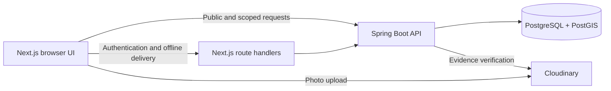

# NagrikSetu

A civic issue reporting platform that groups nearby reports into accountable work for municipal teams.

[Live demo](https://nagrik-setu-vn.vercel.app/dashboard) ·
[Repository](https://github.com/vanshnanda08/NagrikSetu) ·
[Application CI](https://github.com/vanshnanda08/NagrikSetu/actions/workflows/ci.yml) ·
[Project guide](PROJECT_DOCUMENTATION.md)

Residents often report the same street problem separately, while repair progress
is difficult to follow. NagrikSetu preserves each report but groups related
observations into one issue, routes work to the relevant department, and exposes
its progress publicly. Citizens, staff, supervisors and administrators have
separate permissions and workspaces.

**Verified for academic/demo browser use.** The hosted examples are labelled
synthetic data around Thapar Institute and nearby Patiala neighbourhoods; they
do not represent municipal adoption or real street conditions.

## Main workflow

**Photo and location → geographic grouping → supervisor assignment → staff repair proof → citizen verification → recorded closure.**

A citizen may report anonymously or sign in to retain ownership and verify a
repair. Eligible rejection reopens work. Timeout resolution is disclosed;
reasoned administrative early closure is distinguished from a successful repair.
Public tracking, maps, dashboards and histories show the recorded outcome.

## Implemented capabilities

- **Bounded geographic clustering:** category-specific radii, GPS accuracy,
  confidence review and extent caps group related observations; database locks
  protect concurrent submissions.
- **Scoped complaint workflows:** department/ward permissions, assignments,
  priority, SLA escalation, paused verification clocks and status histories.
- **Evidence and verification:** hosted photo validation and perceptual hashes,
  repair proof, eligible citizen votes, reopening and audited closure reasons.
- **Supervisor and administrator tools:** grouping review, split/merge previews,
  team performance, existing-record configuration and audit CSV export.
- **Account continuity:** password sign-in, rotating refresh sessions, profile
  settings, following and private clarification with authorized participants.
- **Offline reporting:** persistent drafts and an account-bound outbox use
  idempotency keys during retries. Delivery requires supported browser behavior;
  cold offline opening and closed-browser delivery are not guaranteed.
- **Public accountability:** issue list/map, reference-number tracking,
  department/ward summaries and charts with keyboard readouts and data tables.

## Architecture and technologies



| Layer | Technologies and role |
|---|---|
| Frontend | Next.js 16 App Router, React 19, TypeScript, Tailwind CSS; TanStack Query for server state; React Hook Form/Zod for forms |
| Maps | Leaflet with configured service-area polygons and complaint locations |
| Backend | Java 21, Spring Boot 3.5, Spring Security/JWT, JPA/Hibernate Spatial |
| Data and jobs | PostgreSQL/PostGIS, Flyway migrations, scheduled SLA/verification processing and ShedLock |
| Verification | JUnit/Testcontainers, Vitest and Playwright harnesses |
| Hosting | Vercel frontend, Render Docker API, Supabase database, Cloudinary evidence, GitHub Actions |

The product name is NagrikSetu. Existing `civictrack` package, configuration,
storage and deployment identifiers are intentionally retained for compatibility.

## Run locally

Prerequisites: **JDK 21, Maven 3.9+, Node.js 22, npm, and Docker with Compose**
(or a compatible runtime such as Colima). Use separate terminals from the
repository root.

### 1. Start PostgreSQL/PostGIS

```bash
docker compose up -d db
```

Compose uses PostgreSQL 17/PostGIS. Flyway creates and validates the schema,
reference categories, wards and organization accounts when the API starts.
The named database volume persists across restarts. If an existing volume was
created by another PostgreSQL major version, preserve it and follow the
[setup troubleshooting guidance](PROJECT_DOCUMENTATION.md#common-setup-problems);
do not delete it to make startup succeed.

### 2. Configure and start the backend

Set these variables in your backend terminal or IDE run environment. This is
an environment-value template, **not a shell script**; replace placeholders
privately and do not commit real values.

```dotenv
CIVICTRACK_DEMO_STAFFPASSWORD=<local-only-bootstrap-password>
CORS_ALLOWED_ORIGINS=http://localhost:3000
CLOUDINARY_CLOUD_NAME=<cloud-name>
VERIFY_PHOTO_EVIDENCE=true
```

```bash
cd backend
mvn spring-boot:run -Dspring-boot.run.profiles=demo
```

`demo` initializes municipal accounts that lack a password and compresses
workshop deadlines; it does not reset existing passwords. Register a citizen
locally to rehearse reporting and verification. No working account credentials
are published here.

The Compose database defaults match backend defaults. Other databases use
`DATABASE_URL` (JDBC), `DATABASE_USER` and `DATABASE_PASSWORD`. For realistic
local timings with account bootstrap, use `deploy` and a private `JWT_SECRET`
of at least 32 bytes, distinct from public fixture defaults. Keep `demo` and
`seed` off on the hosted service.

### 3. Configure and start the frontend

Copy `frontend/.env.example` to `frontend/.env.local` if that file does not
already exist. Set:

```dotenv
API_BASE=http://localhost:8080/api/v1
NEXT_PUBLIC_API_BASE=http://localhost:8080/api/v1
NEXT_PUBLIC_CLOUDINARY_CLOUD_NAME=<same-cloud-name-as-backend>
NEXT_PUBLIC_CLOUDINARY_UPLOAD_PRESET=<reviewed-unsigned-upload-preset>
```

```bash
cd frontend
npm ci
npm run dev
```

Open http://localhost:3000/dashboard. API readiness is at
http://localhost:8080/actuator/health/readiness; local API documentation is at
http://localhost:8080/swagger-ui/index.html.

Real reporting and repair proof require the matching Cloudinary configuration
and evidence verification enabled. Private Cloudinary admin keys belong only
on the server; they are not upload-preset values or `NEXT_PUBLIC_` variables.
Spring does not automatically load frontend environment files or
`backend/.env.seed`. The [full setup/environment reference](PROJECT_DOCUMENTATION.md#13-setup-and-installation)
explains profiles, private configuration and fixture-only overrides.

## Tests and verification

Run commands from the indicated directory with the container runtime available:

```bash
# backend/
mvn clean test

# frontend/
npm ci
npm run lint
npx tsc --noEmit
npm run test
npm run build -- --webpack
```

Backend tests include `*Test` and `*IT` against real PostGIS. Browser/API
harnesses are documented in [tools/README.md](tools/README.md); write scenarios
must use a disposable database. Restart a production Next server after rebuilding.

The retained **12 November 2026 acceptance run** recorded 401 backend passes,
two optional skips, 115 frontend passes, lint/types/build, Firefox/WebKit checks
and 19 axe scans. The **13 November deployed closeout** passed 18 municipal
checks and six desktop/mobile layouts without changing production complaints.
Real Cloudinary uploads and the complete repair/verification/closure workflow
also passed in a disposable local database with strict evidence validation.
These are dated results, not a claim that this README update reran those suites.

The [verification record](docs/NON_PHONE_CLOSEOUT.md) distinguishes real
integrations, mocked browser fixtures and deployed checks. Compact synthetic
clustering/concurrency/latency evidence and reproduction commands remain in
[evaluation/](evaluation/README.md); it does not establish production capacity
or accuracy on municipal field data.

## Deployment and operation

Both hosts track `main`. Render builds root `backend` using its Dockerfile and
`deploy` profile; Vercel independently builds root `frontend`. CI validates the
application, while `RENDER_DEPLOY_MODE=external` reports that deployment is
host-managed. A green CI policy job is not rollout proof, and host deployments
are not synchronized with CI completion.

The [verified revisions and dated deployment evidence](docs/NON_PHONE_CLOSEOUT.md#final-handover-status--13-november-2026)
are preserved as a snapshot. Documentation-only commits follow the existing
`[skip ci] [skip render]` convention; Vercel can still publish a docs-only SHA.
No hosting settings are changed for repository presentation.

Backup/recovery, migration discipline, private configuration and scoped media
maintenance are covered in the [handover runbook](docs/DEMO-RUNBOOK.md#maintenance-responsibilities).
Database backups do not include browser drafts or the entire Cloudinary library.
Keep media cleanup dry-run until its scope and retention decision are reviewed.

## Documentation

Start with this README; use the focused documents for detail:

| Document | Contents |
|---|---|
| [Project guide](PROJECT_DOCUMENTATION.md) | Architecture, schema/migrations, environment reference and detailed setup |
| [Demo and handover runbook](docs/DEMO-RUNBOOK.md) | Existing synthetic tickets, read-only demonstration, isolated writable rehearsal and maintenance |
| [Verification record](docs/NON_PHONE_CLOSEOUT.md) | Dated release results, revisions, backup evidence and verification boundaries |
| [Screen map](frontend/SCREENS.md) | Routes, role-specific navigation and supported interactions |
| [Thapar dataset](docs/THAPAR_DATASET.md) | 50 synthetic issue records containing 90 reports; scoped refresh and preservation rules |
| [Evaluation](evaluation/README.md) / [manuscript](paper/README.md) | Reproduction, compact results, research source and attribution |

The guide's [historical evidence index](PROJECT_DOCUMENTATION.md#historical-evidence-index)
preserves superseded reports through immutable Git links. Local private artifacts
and backups are intentionally not distributed with a fresh clone.

## Supported scope and limitations

Verified for academic/demo browser use. Physical-phone and full spoken
screen-reader testing remain **unverified**. Email delivery/password recovery
is **deferred**; native installation is **excluded**. Loaded-tab offline reporting
is supported, with the delivery limits stated above. Synthetic data, automated
checks and browser reviews do not establish municipal adoption, production
capacity, universal accessibility compliance or the absence of all defects.

## License

Original project code and documentation use the [MIT License](LICENSE).
Bundled IEEEtran files retain their own LaTeX Project Public License notices;
see [third-party attribution](paper/THIRD_PARTY.md).
